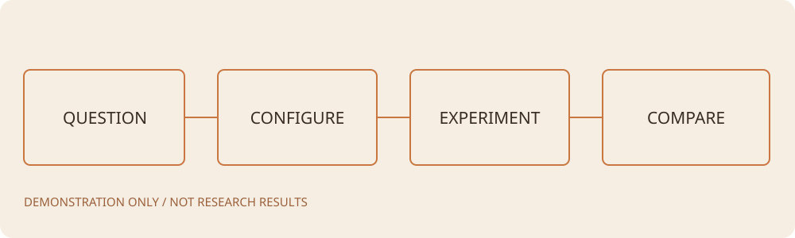

## 记录说明

这是功能演示，所有曲线为确定性生成的合成数据，视频为程序生成的动画，**不是实际实验或论文结果**。可参考组织方式创建自己的项目。

## 方法整体框架

## 复现步骤与原因

1. 先固定任务、代码版本和评估协议，避免把设置变化误当成方法提升。
2. 保存原始 CSV，再配置横轴和纵轴的实际列，避免依靠固定列名猜测。
3. 为每次改进保留独立实验编号和配置，便于回到基线比较。
4. 在实验结果页选择本项目或其他项目的 CSV；对比时确认横轴含义与指标单位一致。

## 如何读这些曲线

横轴为演示迭代次数，纵轴为无单位的合成分数。使用平滑只改变展示，不改写 CSV。空值应显示为断点，不能当成零。

## 未解决问题

本示例没有实际机器人运行记录，因此不能据此推断任何方法的效果。
