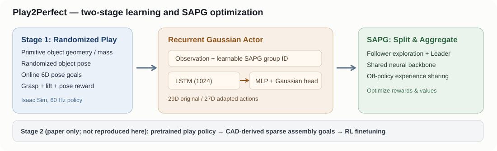
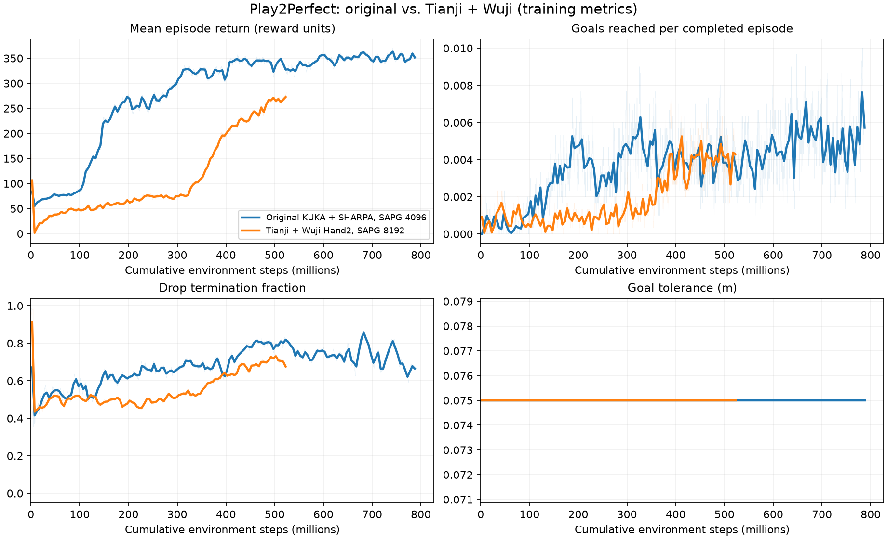

# Play2Perfect — Play 阶段复现与机器人适配对比

> **实验状态：两轮训练均完整结束，策略没有可靠地完成随机 6D Goal。** 原生 KUKA + SHARPA 的训练累计奖励比 Tianji + Wuji 更高，但两个 final checkpoint 的独立确定性评估均为零目标成功。网站附上**未经过美化或插值的 TensorBoard 标量 CSV**与两段**真实 Isaac Sim RTX RGB**最终视频，视频展示失败/不完整操作，**不是成功案例**。这不是论文论文结果的复刻，也不是作者的公开预训练 checkpoint 的演示。

## 快速导航

- [方法结构与问题定义](#方法结构与问题定义)
- [SAPG 的策略组和网络细节](#sapg-的策略组和网络细节)
- [Play 任务设计与梯度更新](#play-任务设计与梯度更新)
- [代码实现与调用链](#代码实现与调用链)
- [实验环境、版本与命令](#实验环境版本与命令)
- [两组实验结果](#两组实验结果)
- [曲线比较与解释](#曲线比较与解释)
- [RGB 视频及重设相机](#rgb-视频及重设相机)
- [实施历史与完整过程日志](#实施历史与完整过程日志)
- [开放问题和 TODO](#开放问题和-todo)
- [网站发布记录](#网站发布记录)

## 方法结构与问题定义

论文：[Play2Perfect: What Matters in Dexterous Play Pretraining for Precise Assembly?](https://arxiv.org/abs/2606.26428)，Tyler Ga Wei Lum、Kushal Kedia、C. Karen Liu、Jeannette Bohg（2026）。上游代码：[kushal2000/play2perfect](https://github.com/kushal2000/play2perfect)，实验采用的基础 commit 为 [`ff2fc62873f6c6cd93164123c8358e9ce2d65c9b`](https://github.com/kushal2000/play2perfect/tree/ff2fc62873f6c6cd93164123c8358e9ce2d65c9b)。本次只复现 **Stage 1 Play**，没有训练/验证下游 CAD Assembly Stage 2。

研究问题不是“能否模仿一条演示轨迹”，而是：能否用随机形状与随机动力学的物体，让灵巧手仅靠交互奖励学会抓取、抬升、物体内部重定向（in-hand reorientation）和连续 6D 目标跟踪，并为下游精准装配提供可微调的策略先验。



完整流程是：Isaac Sim 并行随机几何环境 → 机器人和物体观测 → SAPG 条件策略 / LSTM + MLP → 29D（Wuji 版 27D）高斯动作 → 关节目标和 PhysX 接触仿真 → 物体关键点与 Goal 的距离 → 分阶段奖励和终止 → 16-step rollout → PPO/SAPG Actor-Critic 更新。作者在 Stage 2 使用 CAD-derived 中间装配位姿与稀疏奖励继续微调，但**不是这次两组训练的内容**。

这里有三种必须分开的知识来源：

1. **论文**：Play 预训练论文原报告为 RTX A6000 ×1、24,576 环境、运行 7 天；原文并没有给出确切总 epochs。下游微调另用 12,228 环境、约一天预算；这些不是我们本次的实测结果。
2. **上游源码**：默认 `PlaySAPG.yaml`、`Play.yaml`、`rl_games` 定义了现有实际实现，包括从 0.075 开始逐步下降的课程容差、LSTM Actor、4 层 MLP Critic 与 SAPG 的共享探索结构。
3. **本地改造与实验**：4096 环境原生 KUKA + SHARPA 与 8192 环境 Tianji + Wuji。环境数、资产数、策略组数量、机器人几何和计算预算都没有与论文完全一致，因此**不能用本实验的绝对成绩直接判定论文是否复现成功**。

### 环境观测、动作及张量形状

Actor 的 140D（原生）观测是`joint_pos` (29)、`joint_vel` (29)、`prev_action_targets` (29)、`palm_pos` (3)、`palm_rot` (4)、`object_rot` (4)、`fingertip_pos_rel_palm` (15)、`keypoints_rel_palm` (12)、`keypoints_rel_goal` (12)、`object_scales` (3)。Wuji 版对应 27 DoF，观测变为 134D。物体的平移位置信息隐含在相对物体关键点观测中，并非通过单独的绝对物体位置字段提供。

非对称 Critic 获取额外的无噪声状态、速度、过程与奖励量，原生原始 state 为 162D，Wuji 版 156D；它仅在训练时辅助价值估计，不属于部署所需观测。原生动作维度 29 = IIWA14 机械臂 7 + SHARPA 灵巧手 22；Wuji 动作 27 = Tianji 7 + Wuji Hand2 20。**机械臂**动作是积分到此前关节目标上的增量，**手指**动作直接映射至允许关节范围的绝对目标，随后都经平滑及限位，不是纯力矩控制。

## SAPG 的策略组和网络细节

SAPG = Split and Aggregate Policy Gradients（拆分与聚合策略梯度），是基于 PPO（Proximal Policy Optimization，近端策略优化）的多策略探索/聚合算法，**不是 Play2Perfect 提出的新神经网络模型**。不同策略组在一个共享主干上使用各自可训练条件向量及高斯动作标准差，执行不同强度的熵正则化探索。

令策略组编号为 i，观测为 `o_t`。从`extra_params`中选择 32D 学习向量 `e_i`，则 SAPG Actor 条件输入 `x_t=[o_t;e_i]`；原生张量 140+32=172D，Wuji 版 134+32=166D。神经网络依次为：

- **LSTM**（Long Short-Term Memory，长短期记忆网络）：单层，隐藏大小 1024，训练时采用长度 16 的序列；隐藏状态随仿真交互传递并按 done mask 重置。其作用是利用动作-响应历史表示没有显式测量的摩擦、惯量及接触状态。
- **LayerNorm(1024)** 后经过 **MLP**（Multi-Layer Perceptron，多层感知机）：`1024 → 1024 → 1024 → 512 → 512`，各全连接层后使用 ELU 激活，最终 512D 特征。
- **Action Mean Head**：`Linear(512,29)`（原生）或 `Linear(512,27)`（Wuji）输出 `μ_t`。
- **Log-Std Head**：一个按 SAPG 组索引的可训练表，原生 2×29，Wuji 4×27；`σ_i=exp(logσ_i)`，采样 `a_t ∼ Normal(μ_t,diag(σ_i²))`。均值层没有输出 Tanh，环境前裁剪动作到 [-1,1]；确定性推理使用 `μ_t`。
- **Central Value Critic**：独立特权状态网络，原生输入 162+32=194D，Wuji 156+32=188D；MLP 为 1024、1024、512、512，输出 `V(s)∈R`。源码 Actor 模型内部也含 512→1 的 Value Head，训练同时另有独立的非对称特权 Critic。

原生实验指定 4096 环境 / 2048 每组，故 2 组（一个探索 Follower 与一个 Leader），额外熵系数为 [0.001,0]；Wuji 指定 8192 / 2048，故为 4 组（3 个 Follower、1 个 Leader），熵系数线性变化到 0。网络条件 embedding 与不同 std 使策略输出不同动作分布，但**不能保证每组必然发现不同抓取模式**。

每轮先收集 `H=16` 步训练数据。对每个组自己的数据，使用常规 Clipped PPO surrogate（设 `r=π_new(a|o)/π_old(a|o)`）：

\[
L_{\mathrm{PPO}}=\mathbb E[\min(r\hat A,\operatorname{clip}(r,1-\epsilon,1+\epsilon)\hat A)].
\]

SAPG 的 Leader 另外吸收选中的 Follower 轨迹，其设计意图是使用 Importance Sampling（重要性采样）修正跨策略分布差异。原始 SAPG 论文的离策略裁剪区间使用基于两策略概率比的修正；**当前 Play2Perfect vendored `rl_games` 中实际 Actor Loss 调用常规 PPO 裁剪 `[1-ε,1+ε]`，并未核实与 SAPG 原论文 Equation (3) 逐式完全等价**。这是可复现性上的保留项，而不是宣称算法错误。Wuji / 原生两个实验均使用当前公开实现，因此它不构成这两组代码路径的主要差异。

## Play 任务设计与梯度更新

### 程序化随机物体与目标

训练对象取自 hammer、screwdriver、marker、spatula、eraser、brush 等类别，使用组合立方体/圆柱体生成不同尺寸和质量分布。配置为每类 100 时生成 1200 个变体（具体包含不同参数分布）；Wuji 实验每类 20，生成 240 个。**物体几何在 scene 构建期间分配给每个环境，环境内的 reset 主要随机化初始位姿与目标，并非每个 episode 都重新生成一套 mesh**。

每次 reset 随机初始关节、物体位姿和第一个 6D goal。达到目标后以位移约 ±0.1 m 和任意轴最高 ±90° 重新采样下一个 goal，促使同一 episode 中连续操作。论文的设计目标是从抬升进步到稳定的指内重定向，而不是完成固定的一个抓取姿态。

### 关键点位姿误差

物体姿态可写为 `(R_o,t_o)`，目标为 `(R_g,t_g)`，给定局部关键点 `k_j`，源码构建当前与目标世界坐标后计算：

\[
d_{\mathrm{pose}}(o,g)=\max_j\|R_ok_j+t_o-(R_gk_j+t_g)\|_2.
\]

四关键点构造同时敏感于平移和旋转；奖励实现默认使用固定尺寸的关键点，因此不会让大型物体天然获得较大的方向误差惩罚。Actor 的相对关键点提供目标误差，但**模型没有显式接触力输入，也没有预测未来轨迹**。

### 奖励与结束

源码 `compute_rewards()` 分别累加指尖接近进步、抬升高度、首次抬升奖励、抬升后关键点距离改善、成功奖金与关节速度惩罚，结构可写为：

\[
r=r_{\mathrm{approach}}+r_{\mathrm{lift}}+r_{\mathrm{lift\_bonus}}
+r_{\mathrm{keypoint}}+r_{\mathrm{goal\_bonus}}-c_{\mathrm{arm}}-c_{\mathrm{hand}}.
\]

首次跨过抬升高度阈值带来较大的奖励，但它**不等于真正达到当前 6D goal**。当 `success_steps=10` 的近目标步数累计达到要求时，才视为一次目标成功并随机重设下一个 goal；物体跌落或 episode 超时触发终止。训练奖励尺度进入优化前另外经过 `reward_shaper.scale_value=0.01`，TensorBoard 所记录的部分 episode 指标仍以原环境奖励为单位。

`current_success_tolerance` 在 CSV 中始终等于配置参数 **0.075 m**。需要注意源码 `obs_utils.py` 在 Play 分支执行 `tol = current_success_tolerance * reward.keypoint_scale`，本实验 `keypoint_scale=1.5`；因此实际用于 `keypoints_max_dist` 判断的距离阈值为 **0.1125 m**，不能不加说明就把 0.075 标量解释成最终物理精度。论文强调的是最终 1 cm 精度，本次两次训练均未把课程配置推进到 0.01。

### Train / Eval / RGB 的区别

训练使用 SAPG 随机动作、并行环境滚动采样、Actor-Critic 反向传播及更新；训练阶段记录 TensorBoard。独立 eval 加载 final checkpoint、设置 `leader_only=true`、`deterministic=true`，不执行参数更新；历史自动评估每个 final checkpoint 完成 24 个 episode，均未观察到 goals 成功。

本次重做的 RGB 片段使用**单环境**、`960×720 @ 60 FPS`、6 秒，`viewer.eye=[0.38,-0.78,1.08]`、`viewer.lookat=[0,0.02,0.65]`。它们来自真实 Isaac Sim 的 RTX `rgb_array` / Gym `RecordVideo`，区别于先前从 PhysX 状态重画的骨架动画。RGB 片段是可视化证据，**不是独立统计评价**，单环境画面里可能有 episode reset。

## 代码实现与调用链

下列原版代码链接固定在 **`ff2fc62873f6c6cd93164123c8358e9ce2d65c9b`**；本地修改仅位于两台 amax 上的开发工作树，**未上传到官方上游仓库**。文件 URI 仅供使用对应机器的编辑器访问，公开网页无法打开本地文件。行号在已核实的工作树中有效；若迁移提交应同时依据函数/类名定位。

| 模块 | 本地代码入口（机器 amax） | 关键符号和行号 | 输入 → 输出与意义 | 公开原版代码 |
| --- | --- | --- | --- | --- |
| 训练入口 | [`isaacsimenvs/train.py`](file:///home/amax/jyzWS/forkRepo/play2perfect_native/isaacsimenvs/train.py) | `main()` L37、`run()` L123 | CLI / Hydra → Isaac 环境 → rl_games Runner | [原版入口](https://github.com/kushal2000/play2perfect/blob/ff2fc62873f6c6cd93164123c8358e9ce2d65c9b/isaacsimenvs/train.py) |
| 场景和随机资产 | [`scene_utils.py`](file:///home/amax/jyzWS/forkRepo/play2perfect_native/isaacsimenvs/tasks/play/utils/scene_utils.py) | `setup_scene()` L1559 | 资产/环境参数 → Robot, Table, Object, Goal | [原版场景](https://github.com/kushal2000/play2perfect/blob/ff2fc62873f6c6cd93164123c8358e9ce2d65c9b/isaacsimenvs/tasks/play/utils/scene_utils.py) |
| 目标分布 | [`goal_sampling.py`](file:///home/amax/jyzWS/forkRepo/play2perfect_native/isaacsimenvs/tasks/play/utils/goal_sampling.py) | `sample_absolute_goal_pose()` L21、`sample_delta_goal_pose()` L36 | 边界/上一个 6D goal → 新 6D goal | [原版目标](https://github.com/kushal2000/play2perfect/blob/ff2fc62873f6c6cd93164123c8358e9ce2d65c9b/isaacsimenvs/tasks/play/utils/goal_sampling.py) |
| 观测和关键点 | [`obs_utils.py`](file:///home/amax/jyzWS/forkRepo/play2perfect_native/isaacsimenvs/tasks/play/utils/obs_utils.py) | `build_observations()` L231 | q、指尖、物体/goal → Actor 140D / Critic 162D | [原版观测](https://github.com/kushal2000/play2perfect/blob/ff2fc62873f6c6cd93164123c8358e9ce2d65c9b/isaacsimenvs/tasks/play/utils/obs_utils.py) |
| 动作处理 | [`action_utils.py`](file:///home/amax/jyzWS/forkRepo/play2perfect_native/isaacsimenvs/tasks/play/utils/action_utils.py) | `apply_action_pipeline()` L18 | [-1,1] 29D → 平滑后的关节位置目标 | [原版动作](https://github.com/kushal2000/play2perfect/blob/ff2fc62873f6c6cd93164123c8358e9ce2d65c9b/isaacsimenvs/tasks/play/utils/action_utils.py) |
| 奖励和终止 | [`reward_utils.py`](file:///home/amax/jyzWS/forkRepo/play2perfect_native/isaacsimenvs/tasks/play/utils/reward_utils.py) / [`termination_utils.py`](file:///home/amax/jyzWS/forkRepo/play2perfect_native/isaacsimenvs/tasks/play/utils/termination_utils.py) | `compute_rewards()` L92；`compute_terminations()` L39 | 物理状态 → 多项奖励 / done / curriculum | [奖励](https://github.com/kushal2000/play2perfect/blob/ff2fc62873f6c6cd93164123c8358e9ce2d65c9b/isaacsimenvs/tasks/play/utils/reward_utils.py) |
| SAPG 数据聚合 | [`a2c_common.py`](file:///home/amax/jyzWS/forkRepo/play2perfect_native/rl_games/rl_games/common/a2c_common.py) | `augment_batch_for_mixed_expl()` L978；`train_epoch()` L1371 | 条件组 rollout → Leader+Follower 更新批次 | [原版 SAPG](https://github.com/kushal2000/play2perfect/blob/ff2fc62873f6c6cd93164123c8358e9ce2d65c9b/rl_games/rl_games/common/a2c_common.py) |
| 网络/概率输出 | [`network_builder.py`](file:///home/amax/jyzWS/forkRepo/play2perfect_native/rl_games/rl_games/algos_torch/network_builder.py) / [`models.py`](file:///home/amax/jyzWS/forkRepo/play2perfect_native/rl_games/rl_games/algos_torch/models.py) | `A2CBuilder` L183；`ModelA2CContinuousLogStd` L245 | 观测+group → LSTM/MLP/μ/logσ → 高斯分布 | [网络](https://github.com/kushal2000/play2perfect/blob/ff2fc62873f6c6cd93164123c8358e9ce2d65c9b/rl_games/rl_games/algos_torch/network_builder.py) |
| PPO 损失 | [`common_losses.py`](file:///home/amax/jyzWS/forkRepo/play2perfect_native/rl_games/rl_games/common/common_losses.py) / [`a2c_continuous.py`](file:///home/amax/jyzWS/forkRepo/play2perfect_native/rl_games/rl_games/algos_torch/a2c_continuous.py) | `actor_loss()` L39；`calc_gradients()` L105 | Ratio / advantage → Clipped PPO + Critic loss | [损失](https://github.com/kushal2000/play2perfect/blob/ff2fc62873f6c6cd93164123c8358e9ce2d65c9b/rl_games/rl_games/common/common_losses.py) |
| Wuji 资产变换 | [`build_tianji_wuji_urdf.py`](file:///home/amax/jyzWS/forkRepo/play2perfect/scripts/build_tianji_wuji_urdf.py) | `combine()` L25；`robot_profiles.py` | Tianji+Wuji 两 URDF → 合并 27DoF 的本机 URDF | 仅本地适配，尚无公开 permalink |
| 训练 / 数据导出 | [`run_native_sapg_4096.sh`](file:///home/amax/jyzWS/forkRepo/play2perfect_native/scripts/run_native_sapg_4096.sh)、[`export_experimentrecord.py`](file:///home/amax/jyzWS/forkRepo/play2perfect_native/scripts/export_experimentrecord.py) | 训练入口与 `collect()`、`plot()` | 本地配置 → checkpoint/TensorBoard → CSV/PNG | 仅本地辅助脚本 |

实际调用链：`isaacsimenvs/train.py` 先启动 Kit / Hydra，从 `PlayEnvCfg` 生成 Isaac Lab DirectRLEnv；`setup_scene` 生成物体与物理视图；`reset_env_state` 初始化 q、物体与目标；每步 `build_observations` 将 140D（134D）状态传给策略，`apply_action_pipeline` 控制物理引擎；`compute_rewards / compute_terminations` 输出奖励和 done；`rl_games/torch_runner.py` 使用 SAPG 数据聚合与 Actor-Critic 迭代，并写入 checkpoint 与 TensorBoard。推理 `--test` 从 checkpoint 加载策略，`--capture_video` 使用 RTX 的真实 RGB 帧。

## 实验环境、版本与命令

| 项 | 原生 KUKA + SHARPA（实验 001） | Tianji + Wuji Hand2（实验 002） |
| --- | --- | --- |
| 任务/类型 | Play 原生复现，`reproduction` | 替换真实目标机器人资产的适配实验，`improvement`；**不表示成绩改善** |
| 机器、GPU | amax，NVIDIA RTX 4090、驱动 580.178.04 | 同一台 amax、同一张 GPU |
| 仿真环境 | Isaac Sim 5.1.0，Isaac Lab 2.3.2，conda `isaaclab232`（Python 3.11） | 同左；项目内 `.venv_play232` 引用基础 conda 环境 |
| 本地代码根目录 / cwd | `/home/amax/jyzWS/forkRepo/play2perfect_native` | `/home/amax/jyzWS/forkRepo/play2perfect` |
| 本地代码提交 | `e8575894d6fc3ab9a857261c6cb5ede7e0b0bb0f`（运行后补记录另有提交） | `778f85e4378495177dd849ff5ddd467f1d0c3648`（正式训练来自更早的 `ebe6dc5` 代码快照） |
| 训练输出 | `outputs/native_sapg_4096_20261012/` | `outputs/formal_sapg_8192_20261012/` |
| 随机种子 | 42 | 42 |
| 并行环境、SAPG 组 | 4096、2 组×2048 | 8192、4 组×2048 |
| 程序化对象分布 | 1200 个随机 URDF 变体 | 240 个随机 URDF 变体 |
| 动作/Actor/Critic | 29D / 140D / 162D | 27D / 134D / 156D |
| 优化预算 | 12000 epochs × 16 rollout steps | 4000 epochs × 16 rollout steps |
| 累计交互步（理论） | 786,432,000 | 524,288,000 |
| 稀疏权重保存 | 500、2000、4500、8000，以及 final、best | 200、800、1800、3200，以及 final、best |
| 公开权重使用 | 无；**从随机初始化训练** | 无；**从随机初始化训练** |
| 代码具体差异 | 官方原生 29DoF + 评估播放器修复 | 替换 USD/URDF、固定挂载变换、初始关节/控制参数及 27DoF 映射；源算法不改 |

完整原生启动命令（已执行，Job 179，实际使用的是其封装脚本）：

```bash
cd /home/amax/jyzWS/forkRepo/play2perfect_native
bash scripts/run_native_sapg_4096.sh
```

Wuji 命令（已执行，Job 121）：

```bash
cd /home/amax/jyzWS/forkRepo/play2perfect
bash scripts/run_formal_sapg_8192.sh
```

CSV 保留完整 TensorBoard 原始点，仅以 `environment_steps` 作为共同横轴。两个 experiment 的每个训练 epoch 交互步不同：原生 `4096×16=65536`，Wuji `8192×16=131072`，所以**不能直接将 4000 与 12000 epochs 用相同横轴比较学习效率**。

## 两组实验结果

### 训练执行与最终独立测试

| 指标 | 原生 KUKA + SHARPA | Tianji + Wuji |
| --- | ---: | ---: |
| 开始（北京时间） | 2026-10-12 14:22:43 | 2026-10-12 01:55:51 |
| 训练结束 | 2026-10-12 18:30:33 | 2026-10-12 03:33:46 |
| 训练用时 | 4 小时 7 分 50 秒 | 1 小时 37 分 55 秒 |
| 完成 epochs | 12000 / 12000 | 4000 / 4000 |
| 最后可用 episode reward 标量 | 350.394836（epoch 11999） | 279.839752（epoch 4000） |
| 最近 100 个非空 reward 点均值 | 357.592876 | 267.139660 |
| 最后 goals-per-episode 标量 | 0.004333 | 0.003667 |
| 最后 drop termination fraction | 0.6640 | 0.6860 |
| 最后 keypoint reward | 7.839069 | 3.345559 |
| `current_success_tolerance` 配置标量 | 0.075 | 0.075 |
| final 确定性 Leader 评估 | **24 个已完成 episode，目标成功 0** | **24 个已完成 episode，目标成功 0** |

> 原生实验 TensorBoard 的某些 `episode_*` tag 在最后 epoch (12000) 没有新标量，取最后实际记录的 epoch 11999；**不是复制前一个值来假装最后一点**。CSV 的缺失样本保留为空格，不将缺失值补 0。

这组独立评估使用原生评估入口，原生为 4 个小环境、Wuji 为 8 个小环境，分别完成 24 个 episode。它们都没有达到作者原文所期待的稳定精准 6D Goal Manipulation，**不能写成“原生论文已经复现成功”**。

### 与论文预算的差距

论文 Appendix B 报告 Play 预训练为 **RTX A6000、24,576 环境、连续 7 天**；本地原生只使用 4096 环境、训练约 4 小时，Wuji 8192 环境、约 1.6 小时。训练原理相近但环境数、几何分布和预算差异显著，因此不足以支持或否定论文中“通过 7 天预训练学习到可迁移 Manipulation Prior”的主张。论文没有给出可靠的实际 epochs，不能将 12000 当作作者原训练轮数。

## 曲线比较与解释



这张比较图只为方便阅读，将曲线按 **500 万 environment-steps 作为一个分箱**求均值，并将未平滑的原始点淡化叠加；**发布的 CSV 完全保留原始 TensorBoard 值，不应用分箱、不插值**。网站“实验结果”页可单独选择两项实验的对应指标，按真实原始点、不同平滑强度绘图和下载 CSV。其横轴 `environment_steps` 来自 TensorBoard event step，而非凭空从 epoch 反推。

1. **累计奖励**：原生曲线整体上升更早、更快；Wuji 在较长初期稳定于较低奖励，后半段显著增长。奖励受手型、物体质量和大量抬升奖励影响，无法直接解释为目标成功率。
2. **目标成功**：两组 `episode_final/successes` 都是**每完成 episode 的平均目标完成次数**，量纲 `goals/episode`，不是百分比 Success Rate。最后记录约 0.004333 vs 0.003667，尽管不完全为零，仍极少。原生与 Wuji 在 **同为 524,156,928 环境步**的单点：原生奖励约 322.2069、goals/episode 约 0.002667；Wuji 奖励约 279.8398、goals/episode 约 0.003667。此时不能宣称原生在每项指标都优于 Wuji。
3. **掉落**：原生末尾掉落终止约 66.4%，Wuji 约 68.6%，都偏高；有样本超时不代表完成目标。原生较高的抬升奖励也可能意味着学到了抬升却无法维持稳定操作。
4. **课程容差**：全程停留在配置参数 0.075，未逐渐降至最终 0.01；代码判断时存在乘以 `keypoint_scale=1.5` 的实现细节。**曲线没有证明策略学会厘米级操作**。

与实验结果可共同支持的有限结论是：两个版本训练管线都能完成非常大规模的更新、获得非零形状奖励、产生视频，但**两次 final 独立测试的目标成功率都是 0 / 24**。SAPG 本身、场景几何与手指物理适配仍有不足；特别是 Wuji 的指尖/palm 观测 offset、Tianji-Wuji 连接变换和 PD 控制增益并未做真机级校准，只是当前差异的**可能原因**，不能未经对照实验就认定是哪一个导致失败。

## RGB 视频及重设相机

下方网站的“实验结果”页**只发布两段 final checkpoint 视频**，不把五阶段全部视频、模型 checkpoint 或训练日志复制到 GitHub：

- **实验 001 原生**：`runs/native/final-rgb.mp4`；原生 KUKA + SHARPA、final epoch 12000 checkpoint，leader-only，单环境 RTX RGB，960×720、60 FPS、6.00 秒、H.264。完整原视频位置：[`amax：rgb_final_native_20261013`](file:///home/amax/jyzWS/forkRepo/play2perfect_native/outputs/rgb_final_native_20261013/videos/rl-video-step-0.mp4)。SHA256：`4bbb40ca32b5e9f9af2564f9b5576284920d56547f8ed2d22c6d8098f3f1f2c2`。
- **实验 002 Wuji**：`runs/wuji/final-rgb.mp4`；Tianji + Wuji Hand2、final epoch 4000 checkpoint，同样 leader-only、单环境、960×720、60 FPS、6.00 秒。完整原视频：[`amax：rgb_final_wuji_20261013`](file:///home/amax/jyzWS/forkRepo/play2perfect/outputs/rgb_final_wuji_20261013/videos/rl-video-step-0.mp4)。SHA256：`a27782bc01167f5468380fc6e3289a1ae6478aaa31cfaa5d17aa2acfa9a7795c`。

历史的 RGB 视频同时显示多个环境，导致主体较小、画面部分区域无操作内容。本次改变**评估相机**，不是裁掉失败片段，更未调整训练状态：`num_envs=1`、相机视点 `[0.38,-0.78,1.08]`、观察点 `[0,0.02,0.65]`、分辨率 `[960,720]`；镜头靠近单一操作台，机器人与物体居中。已从视频解码多帧检查，不是静态图/骨架回放。单环境短片可能包含重置或掉落过程，并不展示成功完成一个 Goal。

## 实施历史与完整过程日志

以下步骤均为**实际执行**，不是待运行指令，历史失败和修复不删除。准确到秒的原始时间取自每次训练的 `status.log` 和先前 `process.md`；个别探索性步骤原日志只记录日期，不能杜撰具体执行秒数。

### 2026-10-12 · Wuji 机器人模型准备、校验与第一轮训练

在 amax `/home/amax/jyzWS/forkRepo/play2perfect` 工作树的 `agent_dev/tianji-wuji-play` 分支，从官方仓库 clone 后合并 Tianji 7DoF 与 Wuji Hand2 20DoF 的 URDF。参照路径：[Tianji URDF](file:///home/amax/jyzWS/RevoLab/assets/urdf/Tianji_Revo3/urdf/Tianji_Revo3_Right.urdf)、[Wuji URDF](file:///home/amax/jyzWS/regrind-wujihand2-screwdriver/source/regrind/regrind/assets/wujihand2_beta2_right/urdf/right.urdf)；使用 `scripts/build_tianji_wuji_urdf.py` 实现关节/mesh 合并。建立 27D action、134D actor obs、156D critic；该固定手腕安装不是硬件标定结果。

先完成 4 环境 ×20 控制步物理 smoke，64 环境 ×20 epochs PPO smoke，512 环境 ×800 epochs PPO（约 655 万环境步，最终独立推理 8/8 episode 无目标成功），再完成 64 环境 ×10 epochs SAPG 验证；均用真实训练程序和模型检验。发现 RTX RecordVideo 在之前的高开销测试有 Shader 编译问题，先使用物理状态离线骨架视频保证验证入口可用，保留失败记录。

### 2026-10-12 01:55:51–03:37:17 +08:00 · Wuji SAPG 正式实验

**关联实验 002**。执行：

```bash
cd /home/amax/jyzWS/forkRepo/play2perfect
bash scripts/run_formal_sapg_8192.sh
```

任务 ID `121`；4096? **不是**：本次是 8192 env、4 SAPG 组、240 随机几何、4000 epochs、minibatch 32768、seed42，总 524,288,000 环境交互步。开始 01:55:51，训练完成 03:33:46，评估完成 03:37:17。首个 epoch 200 checkpoint 已验证；其他里程碑 epoch 800、1800、3200 也正常落盘。24-episode final 独立确定性测试成功数 0。TensorBoard 指标经 `EventAccumulator` 读取，不伪造中间指标。旧版骨架动画可在 amax 运行目录中追溯，本网站不把它当作 RGB 结果。

### 2026-10-12 14:22:43–18:34:16 +08:00 · 原生 SAPG 从零复现

**关联实验 001**。建立原始代码的独立 worktree `/home/amax/jyzWS/forkRepo/play2perfect_native`，原始上游 commit `ff2fc62`，分支 `agent_dev/native_repro`。不使用已通过 RK 下载到的作者权重：它们仅用于检查可获取性，**未在正式训练中加载**。先完成 32env×3epoch SAPG smoke、原生 Isaac RTX RGB 短视频验证；修复评估播放器`6组硬编码`为可配置组数，允许 deterministic leader-only。该修复不修改训练优化器梯度。

正式启动：

```bash
cd /home/amax/jyzWS/forkRepo/play2perfect_native
bash scripts/run_native_sapg_4096.sh
```

任务 ID `179`，4096 env、2 组 SAPG、1200 随机几何、12000 epochs、minibatch 16384、seed42。场景/PhysX 初始化通过，12,000 epochs 在 18:30:33 完成，真实 reward 约 350、平均 goals 完成数远低于 1。到 18:34:16 顺序完成 2000/4500/8000/best/final 的 RTX RGB 测试，final 24 个已完成 episode 全部无目标成功。训练中一次首次创建 best 软链接出现重试，之后可继续；本地对 `safe_symlink` 的修复**不改变已经在运行的训练进程**。

### 2026-10-13 00:45–00:50 +08:00 · 新相机 / 两个 final checkpoint 真 RGB

**关联实验 001、002 的可视化评估**。因多环境共享相机导致空白和无关环境过多，单独启动仅一个 Isaac 环境的 `--test --capture_video`，从两个训练的 final checkpoint 加载 Leader，指定近距离斜俯视相机位置。测试预览后分别生成 360 帧 60 FPS RGB H.264，检查实际解码的 3 秒画面和总 6 秒时长、尺寸与 SHA256；**无参数更新，不属于额外训练轮次**。完整 Hydra CLI 覆盖写在前面的“RGB 视频”章节；发布仅选一个 final 视频/实验。

### 2026-10-13 · TensorBoard 真数据导出、作图与发布准备

编写 [本地导出脚本](file:///home/amax/jyzWS/forkRepo/play2perfect_native/scripts/export_experimentrecord.py)，分别读取两组事件文件，以原始 event step 做键，把每个 tag 的真实标量落入统一 CSV。不存在的 tag / step 留空，不生成 0 值，也不对原始点进行平滑；生成单独的对照 PNG 以便在文章中快速查看。代码级记录、详细方法、对照事实和原始实验日志并入本地主笔记；准备同步至 ResearchStream ExperimentRecord。

## 数据和发布文件索引

| 来源和核验 | 实验 / CSV 编号 | 清单对应位置 | 语义 |
| --- | --- | --- | --- |
| [原生 TensorBoard](file:///home/amax/jyzWS/forkRepo/play2perfect_native/outputs/native_sapg_4096_20261012/0_native_sapg_4096/summaries/) | 实验001、CSV01 | `runs/native/training.csv` | 真实环境交互步、各项训练奖励、每 episode 目标次数、掉落比例、课程阈值、loss |
| [Wuji TensorBoard](file:///home/amax/jyzWS/forkRepo/play2perfect/outputs/formal_sapg_8192_20261012/0_tianji_wuji_sapg_8192/summaries/) | 实验002、CSV01 | `runs/wuji/training.csv` | 与上一组相同的原始 TensorBoard 标签；不同环境数量通过 x=environment_steps 可对齐 |
| [原生 Hydra](file:///home/amax/jyzWS/forkRepo/play2perfect_native/outputs/native_sapg_4096_20261012/.hydra/config.yaml) | 实验001 | `runs/native/config.yaml` | 真实运行参数快照 |
| [Wuji Hydra](file:///home/amax/jyzWS/forkRepo/play2perfect/outputs/formal_sapg_8192_20261012/.hydra/config.yaml) | 实验002 | `runs/wuji/config.yaml` | 真实运行参数快照 |
| [原生 final RGB](file:///home/amax/jyzWS/forkRepo/play2perfect_native/outputs/rgb_final_native_20261013/videos/rl-video-step-0.mp4) | 实验001 | `runs/native/final-rgb.mp4` | 6 秒真实 Isaac RGB、只上传此片 |
| [Wuji final RGB](file:///home/amax/jyzWS/forkRepo/play2perfect/outputs/rgb_final_wuji_20261013/videos/rl-video-step-0.mp4) | 实验002 | `runs/wuji/final-rgb.mp4` | 6 秒真实 Isaac RGB、只上传此片 |
| 本机原始训练事件处理图 | 图像 | `assets/training_comparison.png` | 每 5M 环境步分箱后的可读曲线，原始点仍在 CSV |

指标定义（网站叠加时保持 quantity 与 unit 精确一致）：`environment_steps`：`environment-interaction` / `count`；`episode_reward`：`episodic-return` / `reward`；`goals_per_episode`：`completed-goals-per-episode` / `goals/episode`；`fall_fraction`：`drop-termination-fraction` / `fraction`；`tolerance_m`：`curriculum-tolerance-parameter` / `m`。指标表头与 CSV 一致，没有单位换算。`episode_final/successes` 不是样本级成功率，**不能把 0.004 当成 0.4% Success Rate**。

## 开放问题和 TODO

- [x] Isaac Lab 2.3.2 上两组正式训练均完成、未覆盖旧模型/旧日志。
- [x] 根据实际 TensorBoard 事件导出两个可叠加的真实曲线 CSV；缺失值不伪造。
- [x] 重新设置镜头，录制原生和 Wuji final 的 2 个 960×720 RGB 视频（真实 RTX，而非骨架）。
- [ ] 两组 final 都未学成可靠 6D goal control。下一步应分离“能抬升”“保持抓取”“物体位姿误差下降”“完整成功次数”，进行逐阶段行为统计与视频诊断。
- [ ] 校准 Tianji-Wuji 真实安装变换、关节 PD 和指尖观测偏置；排查物体初始位姿、目标可达性和 reward imbalance。
- [ ] 按原论文 7 天、24,576 环境的相近环境交互预算做公平对照；此处的 4096×12000 / 8192×4000 不是论文的完整预算。
- [ ] 对齐不同机器人、随机物体集合和 SAPG 组数后再比较架构/算法本身；当前比较是一组工程适配测试，不是单变量随机对照实验。
- [ ] SAPG 源码中 Off-policy 裁剪与原论文 Equation (3) 的差异需要单独测试，不应将它未经验证地视为引起失败的根因。
- [ ] 论文后续 Stage 2 精密装配依赖 Play 先验；在 Stage 1 尚未形成可靠控制前，不宜声称有下游装配能力。


## 既有本地操作日志全文（保留原始失败与修复）

以下为两份项目此前的原始 process.md 文本，仅将 Markdown 标题层级下调，不删减任何操作记录；前面已经按核验结果更新了最终事实，历史中的“待核验”应按当时记录解释。

### 原生 KUKA + SHARPA 早期 process.md

### 原生 Play2Perfect — KUKA + SHARPA SAPG 复现

#### 2026-10-12

目标：不使用发布的预训练权重，从随机初始化学习原生 Play 阶段；
仅将真实 Isaac Sim RGB 测试视频提供给 RK，不把权重与训练数据传过去。

- 官方源代码 `ff2fc62`，独立 worktree `/home/amax/jyzWS/forkRepo/play2perfect_native`，分支 `agent_dev/native_repro`；保持 `Play.yaml`、`PlaySAPG.yaml` 及原生机器人 USD/URDF、奖励、物理参数不变。
- 训练基座：Isaac Sim 5.1.0 + Isaac Lab 2.3.2；直接复用 `isaaclab232` 环境，不重装系统。命令见 `scripts/run_native_sapg_4096.sh`。
- 原生最小验证：32 env，2 个 SAPG block，3 epochs 已真实完成，Actor input 140D、Critic state 162D、action 29D；训练正常退出。该测试长度不足一整个 episode，无权宣称策略有效。
- 原生 RTX 真实视频验证：2 env、8 epoch PPO 随机起点，得到 `outputs/native_rgb_capture_validation_20261012/videos/rl-video-step-0.mp4`（H.264，640×480，真实机器人/物体/桌面画面）；仅验证录像管线，**不是策略成功演示**。
- 训练设置：4096 env，`expl_coef_block_size=2048` 组成 2 个策略组，保留 Leader+Follower SAPG；官方默认 `num_assets_per_type=100`，6 类对象×2 类参数分布×100 = 1200 个几何变体；`max_epochs=12000`，预计 786,432,000 environment frames；seed42；16步 horizon；minibatch16384；save_frequency500（上游平方间隔算法实际在500/2000/4500/8000保存，再保留final、best、滚动last）。
- 原始环境目标：物体 6D pose tracking；随机 object/goal；SAPG 训练（off-policy 聚合、探索条件参数）、原生 29DoF 控制均不改。
- 修复范围**仅涉及评估**：`rl_games/rl_games/algos_torch/players.py` 的 6 组硬编码→显式组数；`rl_games/rl_games/common/player.py` 添加 `leader_only` 选项用于加载 trained leader。这两处属于 inference player 代码，训练 Actor-Critic 与 PPO/SAPG gradient implementation 不变。训练入口另有1行状态日志。
- 自动评估：正式训练结束后对 ep2000、4500、8000、best、final 的权重各启动单独小规模 Isaac RTX RGB 回放，路径 `outputs/native_sapg_4096_20261012/eval/<stage>/videos/`。默认录制360帧，真实 sim RGB，测试样本量每阶段24个完成episode。若某次评估失败保留日志继续其他checkpoint。
- RK 官方权重下载已经成功（官方 play + 4 assembly），但**本实验不加载这些权重**。未取得论文原始训练完整计算预算与硬件设置，因此即使此次成功/失败都只作为官方代码当前硬件的复现实验，不能先行声称严格复现全部论文指标。

#### TODO

- [x] 原生环境与 SAPG smoke
- [x] Isaac RTX 真 RGB MP4 测试
- [ ] 正式 4096 env 初始化与持续训练
- [ ] TensorBoard 真实 reward/success/done 指标、性能和训练耗时
- [ ] 按计划完成 milestone checkpoints，并生成对应 RGB 视频
- [ ] 向 RK 的 `paper_exp/Play2Perfect/` 只传 RGB 视频和最简解释，不传训练权重/大日志
- [ ] 结合训练结果判断训练预算与论文报告差距，核验泛化与成功指标

##### 实际启动与早期结果（北京时间 2026-10-12）

- amax zshell **Job 179**，使用官方 KUKA+SHARPA + SAPG，4096 env，1200 个原生随机程序化几何；scene creation 用时约 341.6s，已进入 PhysX/实际 PPO-SAPG 更新。
- 先后通过 32 env SAPG smoke、原生 KUKA/SHARPA Isaac RTX RGB 短视频，以及 2-block SAPG checkpoint 的 leader-only RGB 测试。预训练权重没有用于初始化本轮训练。
- epoch 10 首次 best/model.pth 创建出现 “删除不存在的 symlink” 重试延迟（累计数十秒），随后上游重试自行完成，至 epoch 30 训练继续运行。仅在 vendored rl_games 的 safe_symlink 函数加一个 os.path.lexists 判断，避免今后首次 best 保存重试；对已启动 Python 进程不热更新、不改变优化器。
- 视频验证样例已通过 zshell 保存到 RK：paper_exp/Play2Perfect/native_kuka_sharpa_2026-10-12/rgb_renderer_validation_untrained_sapg.mp4（仅随机/未训练的画面验证，不能代表任务成功）。


### Tianji + Wuji 早期 process.md

### Play2Perfect — Tianji × Wuji Play 复现记录

#### 2026-10-12 | 准备与资产审计

1. **确认来源**：官方仓库 `kushal2000/play2perfect` 已开源，仓库 HEAD 为 `ff2fc62`（克隆时）。Play 阶段基于 Isaac Lab `DirectRLEnv`，原生支持多种随机过程化工具类物体、6D 随机位姿目标（平移和旋转）、keypoint/抓取提升奖励、goal tolerance curriculum，以及 PPO/SAPG。
2. **克隆与隔离**：在 `/home/amax/jyzWS/forkRepo/play2perfect` clone；新建本地分支 `agent_dev/tianji-wuji-play`。复用原有 `/home/amax/IsaacLab-2.3.2` + `isaacsim-5.1.0`，不动其他项目及其训练任务；独立虚拟环境 `.venv_play232` 使用 `--system-site-packages` 继承本机 isaaclab232 的 CUDA/Isaac Lab。
3. **天机资产**：`/home/amax/jyzWS/RevoLab/assets/urdf/Tianji_Revo3/urdf/Tianji_Revo3_Right.urdf`，7 自由度 `Joint1_R...Joint7_R`，原 URDF 把 Revo3 手通过固定关节安装在末端。
4. **Wuji 资产**：`/home/amax/jyzWS/regrind-wujihand2-screwdriver/source/regrind/regrind/assets/wujihand2_beta2_right/urdf/right.urdf`，Wuji Hand2 Beta2 右手，20 个旋转关节，5 个指尖，现有标定 PD 参数见 `wujihand2_joint_specs.py`。
5. **关键适配障碍**：原工程强绑定 KUKA/SHARPA 的 29 维 canonical joint order、`iiwa14_link_7` 参考 palm、指尖 body 正则和 22 个灵巧手关节。直接换 URDF 会在状态和动作映射处失败；需 profile 适配。
6. **统一资产**：新增 `scripts/build_tianji_wuji_urdf.py`，从 Revo3 URDF 保留 Tianji 7DoF 机械臂，拼入 Wuji 20DoF 手，采用初步固定安装偏移及坐标翻转；原二进制资产不复制、不改动。末端安装旋转和零位是仿真初值，**不是标定的实机安装矩阵**。

#### 运行目标与验收

- Stage 0: 生成合并 URDF；验证 mesh 存在、关节数量，导入 Isaac 并读回实际关节和 body name。
- Stage 1: 少环境少物体做纯仿真 smoke；验证 27 维动作、状态、重置、随机物体、随机 6D 目标，检查 nan/爆炸。
- Stage 2: 小规模 PPO 训练、TensorBoard 真实日志、有限断点；观察 reward/goal success，再扩环境数量。
- 不擅自宣称性能复现；尚未验证的参数和训练效果均记录 TODO。
- 工程约束：最小必要改动、浅层函数、清晰注释、少量关键断言而非无意义安全分支；训练记录 TensorBoard；合理保存 10–20 个以内 checkpoint；迭代维护此文、CHANGELOG、git commit。

#### TODO

- [ ] 完成统一 URDF 与 Isaac 导入检查。
- [ ] 添加 profile，保留原版 KUKA Play 不变。
- [ ] 验证 6D goal / objects 的 GPU 实际 rollout。
- [ ] 短训练 smoke & TensorBoard 与后续正式训练方案。

#### 第一轮真实运行与结果

##### Gate 0 — URDF 静态校验

- 命令：`.venv_play232/bin/python scripts/build_tianji_wuji_urdf.py`
- PASS：39 links、27 active joints、68 mesh 路径全部有效。
- 合并安装位姿初步取 Tianji 官方 Revo3 安装偏移 `[0,-0.095,0]`，并让 Wuji 腕局部 X 轴旋转约 π 来调整手指方向。**该刚性变换只用于仿真初始化，真实安装需要重新标定**。

##### Gate 1 — Isaac Lab 2.3.2 物理 smoke（通过）

- 使用 `source /home/amax/isaacsim-5.1.0/setup_conda_env.sh` 加载已有 Isaac Sim。
- 命令：`OMNI_KIT_ACCEPT_EULA=YES PYTHONPATH="$PWD/rl_games:$PWD:$PYTHONPATH" .venv_play232/bin/python scripts/smoke_tianji_wuji.py --headless`。
- 4 env × 20 steps，Isaac 实际导入 **27 joints**，Actor observation `(4,134)`、Critic state `(4,156)`；随机动作、goal/object 6D 状态、奖励、step 及进程退出均正常。退出码 0。
- Isaac URDF 导入会把固定安装关节与五个指尖传感器固定 frame 的刚体合并到相邻 link，属已观察到的 importer 提醒；检查后各 5 个 fingertip body 匹配成功。

##### Gate 2 — PPO 小规模训练（通过管线，策略未学会）

- 用 `MAX_EPOCHS=20 NUM_ENVS=64 OBJECTS_PER_TYPE=2 MINIBATCH_SIZE=1024 SAVE_FREQUENCY=5 bash scripts/train_tianji_wuji.sh`。
- 输出：`outputs/2026-10-12/01-15-56/0_tianji_wuji_play/`；TensorBoard `summaries/events.out.tfevents.1791738967.amax`；checkpoint `nn/*.pth`（权重约 95.8 MiB）。
- 20 epochs 完整结束，退出码 0；最后约 6,443 simulated steps/s；critic/action loss 有限。真实 TensorBoard：`successes=0`；`episode_final/successes=0`；`episode_final/done_fall=1`；`episode_cumulative/bonus_rew=0`；`episode_cumulative/total_reward` 最后完成 episode 统计约 53.39；课程成功阈值保持 0.075 m。**只验证训练系统运作，不可解读为已训练出抓取或 goal-reaching policy**。
- 原 PPO 配置为 4×MLP + LSTM + asymmetric value，使用 vendored rl_games；`--agent rl_games_cfg_entry_point` 与官方 SAPG 默认算法不同，但均由官方仓库提供，后续若追求作者默认训练复现需使用 SAPG，并重新处理 `expl_coef_block_size` 与 env 数量约束。
- 当前 64env×20epoch 仅交互约 2.05 万状态步，远不足以推断收敛；训练日志出现掉落是随机初始策略表现，有待更长训练及验证。
- 修复了一处启动脚本兼容性问题：系统原装的 `setup_conda_env.sh` 在 `set -u` 环境引用未赋值 `ZSH_VERSION` 导致报错；现在先 source 后启用严格变量检查。未修改系统脚本。
- `pip` / `uv` 额外安装 `viser`、`yourdfpy` 等绘图/部署依赖时网络下载中断或停滞；已中止停滞任务，绕过它直接使用本地已装依赖跑通 Play，无需重装 Isaac。上述可选绘图依赖目前仍未配全。

##### Gate 2.1 — 初始几何诊断（通过）

- 脚本：`scripts/diagnose_tianji_wuji.py`；4 env × 100 steps，零动作测初始姿态，退出码 0。
- 示例 env0 初始 palm 约 `(-0.076, 0.011, 0.627)m`；object `(0.046,-0.076,0.619)m`；最近指尖距离 `0.052m`，不是机械手离对象十几米的错误。
- 100 步时 4 物体中心 z 约 `(0.571,0.539,0.549,0.548)m`，接近桌面高度 `0.38+0.15=0.53m`；没有因 URDF/重力方向错误而无动作立即坠落。随机政策导致较多掉落，仍须再验证接触与学习。
- 原作者的随机对象生成在 **scene 初始化时** 为并行 env 分配不同对象，episode reset 随机化每个对象的 pose 和每个 6D goal，*同一个 env 每个 episode 不一定换模型*；切勿将这表述为每回合换所有 mesh。

#### 运行说明

```bash
cd /home/amax/jyzWS/forkRepo/play2perfect
.venv_play232/bin/python scripts/build_tianji_wuji_urdf.py
### 64 env 的调试运行，可用外部环境变量覆盖训练规模和断点间隔
NUM_ENVS=64 OBJECTS_PER_TYPE=4 MAX_EPOCHS=50 SAVE_FREQUENCY=10 bash scripts/train_tianji_wuji.sh
### 查看日志目录 outputs/YYYY-MM-DD/HH-MM-SS/0_tianji_wuji_play/summaries/
/home/amax/.conda/envs/isaaclab232/bin/tensorboard --logdir outputs --port 6006
```

#### 剩余研究问题

- [x] 生成 Tianji+Wuji 统一 URDF，并通过实际 Isaac 导入。
- [x] 27D action、134D actor obs、156D critic state，随机对象与 6D goal 工作。
- [x] PPO 20-epoch smoke、TensorBoard 与 checkpoint 真实产生。
- [x] 通过 100 steps 零动作初始稳定性诊断。
- [ ] 长训练验证 goal success、reward 曲线、接触/掉落统计和不同 shape 泛化。
- [ ] 确认 Wuji 真实 mounting/calibration、各 fingertip pad offset、质量、关节摩擦和自碰撞。
- [ ] 大规模 SAPG 实验与官方基线对照；提供可视化 video/rollout 测试和完整成功率统计。
- [ ] 如训练失败，优先排查落地或接触几何、初始抓取可达性、目标采样分布；不要为了数字好看修改评估成功阈值。


#### Play 方法实现对应关系（2026-10-12）

采用 **官方 Play 代码中的奖励函数和目标采样，不重新设计任务**：

- 每个 scene 生成 6 类 handle-head 物体（hammer, screwdriver, marker, spatula, eraser, brush）；程序中每个类型有不同几何分布，`num_assets_per_type=10` 在大规模训练中实际生成 120 个对象 USD。对象形状在 scene 创建时分配到 env，reset 时更新物体位置姿态和独立目标位姿。
- reset 时 absolute goal 从 `[-0.35,-0.20,0.60]` ~ `[0.35,0.20,0.95]` 米均匀取位置，四元数随机；达成一次目标后以约 0.1m 平移范围、±90° 随机轴转动做 delta goal。核心是 **6D goal-conditioned pose tracking**，不是每次新 goal 都结束 episode。
- Actor `134D`：27 关节位置 + 27 速度 + 27 前次关节控制目标、手掌位置/旋转、物体旋转、五指指尖相对掌位置、物体四关键点相对掌位置与相对目标位置、物体三轴尺度。Critic `156D` 额外接收速度、进度、reward 和成功/接触辅助状态，形成 asymmetric actor-critic。
- Action `27D`：前 7 个对应 Tianji，velocity-target 积分并平滑后给位置驱动；后 20 个对应 Wuji，用 [-1,1] 归一化范围映射到关节上下限，然后平滑。保留上游 Isaac Play 核心动作形式。
- 奖励保持官方组合：抓取前的指尖最近距离改进、抬升奖励与一次性 lift bonus、抬升后的 object/goal 关键点误差改进、goal success bonus，以及机械臂/手关节速度惩罚。是否成功由 4 个 keypoint 的最大误差低于当前 curriculum 阈值并满足 10 个 near-goal steps 决定。
- 域随机化复用上游的观测/动作延迟、object state noise、随机 wrench 等。上述词条仅是保留机制，**不是对 Wuji 真实物理参数的完备识别**。
- 比较边界：更换机器人使模型参数、观察空间、执行器力限和任务几何都不同，结果不应和 KUKA/SHARPA 原论文报告直接量化对照。

#### Gate 3 — 512 环境正式 PPO 实验

- amax zshell Job ID：`67`，启动目录 `/home/amax/jyzWS/forkRepo/play2perfect`。
- 启动：`NUM_ENVS=512 OBJECTS_PER_TYPE=10 MAX_EPOCHS=800 MINIBATCH_SIZE=8192 SAVE_FREQUENCY=80 bash scripts/train_tianji_wuji.sh`。
- 代码 commit：`d4a3196`。这轮配置为 512 env、120 procedural object variants、800 PPO epochs 上限、每 80 epoch 一断点（常规频率约 10 个，中途模型最优/收尾可能额外保存）。
- TensorBoard：`outputs/2026-10-12/01-21-49/0_tianji_wuji_play/summaries/`，可对照 `info/epochs`、`successes`、`episode_final/successes`、`episode_final/done_fall`、`current_success_tolerance`、`episode_cumulative/total_reward`。
- 初始已通过 Kit scene creation、Isaac physics startup 和 PPO 网络初始化。54 epochs 时来自真实 TensorBoard：`info/epochs=54`，`successes=0`，`episode_final/done_fall≈0.51`，`performance/step_fps≈3.8万`；`episode_cumulative/bonus_rew` 有少量非零但尚不能推断完成 goal。最终是否完成、表现如何应以任务结束日志为准。

#### Gate 3 — 512-env PPO 训练最终结果（已结束）

- 运行进程 `Job 67`，退出码 **0**；实验输出路径 `outputs/2026-10-12/01-21-49/0_tianji_wuji_play/`，`last/model.pth`（约 104.7 MB），TensorBoard 文件 `summaries/events.out.tfevents.1791739353.amax`。
- PPO 800/800 epoch，`frames=6,553,600`（最后一个 epoch 记录 `6,545,408` 个 rollout steps，和末次策略更新后的 total frames 统计略有差别），实际 step throughput 常见约 3.3–4.1 万 frames/s。
- 最后训练 TensorBoard：`episode_final/successes≈0.00133`（**每回合完成 goal 的平均次数，并非独立评估成功率**），`successes_max` 历史最高 2，`episode_final/done_fall≈0.39`、`episode_final/done_timeout≈0.605`、`episode_cumulative/total_reward≈33.76`。成功容差仍为 0.075m，**尚无学习成功的证据**。
- `best/model.pth`、`last/model.pth` 以及若干 `nn/` 权重共计 **7 个 checkpoint**，小于预设 10–20 的保护上限；本轮输出占用约 703MB。正常训练成功不等同于策略控制质量达标，保留原始评估口径和失败记录。

#### Gate 4 — 原生 SAPG 配置 smoke（已结束）

- 脚本增加 `AGENT` 环境变量指定 PPO 或 SAPG，默认仍保留 PPO（不修改上游原 YAML）。
- 运行命令：
  ```bash
  AGENT=rl_games_sapg_cfg_entry_point NUM_ENVS=64 OBJECTS_PER_TYPE=2 \
  MAX_EPOCHS=10 MINIBATCH_SIZE=1024 SAVE_FREQUENCY=10 \
  bash scripts/train_tianji_wuji.sh \
    agent.params.config.expl_coef_block_size=32 \
    agent.params.config.name=0_tianji_wuji_play_sapg
  ```
- `Job 85` exit code **0**，10/10 epochs，实际 Actor obs 134D，带 32D coefficient/embedding 的 SAPG critic 网络接受 188D 输入且实际成功更新，TensorBoard `outputs/2026-10-12/01-28-18/0_tianji_wuji_play_sapg/summaries/`，模型 `nn/*.pth`。
- 10 epochs 在该小规模下依旧 `successes=0`；这是训练入口联调而非 SAPG 方法性能复现。正式 SAPG 应配置相符的大规模并行组、更多物体和更长预算，不可从此实验声称 SAPG 优于/劣于 PPO。


#### Gate 5 — Checkpoint 加载与推理评估

- **无渲染评估**：使用 800-epoch PPO 最后权重 `outputs/2026-10-12/01-21-49/0_tianji_wuji_play/last/model.pth`，`Job 95` exit code **0**；8 个并行 env，指定累计完成 8 个 episodes，确定性动作。
- 回放命令：
  ```bash
  NUM_ENVS=8 OBJECTS_PER_TYPE=1 MAX_EPOCHS=1 MINIBATCH_SIZE=128 \
  bash scripts/train_tianji_wuji.sh --test \
      --checkpoint outputs/2026-10-12/01-21-49/0_tianji_wuji_play/last/model.pth \
      agent.params.config.player.games_num=8 \
      agent.params.config.player.deterministic=true \
      agent.params.config.name=0_tianji_wuji_play_eval
  ```
- runner 成功加载权重，确认 action space `(27,)`、obs space `(134,)`，8 个已完成 episodes 的 goal successes **均为 0**。终端 `reward`/`steps` 个别位置打印 NaN 是由于对应 env 没有任何已完成 episode（其 `num_episodes=0`，统计均值为空），不是已经确认发生了策略张量 NaN；不得把它当作模型失败/成功率的直接证据。
- **可选视频录制测试**：`Job 91` 尝试 `--capture_video`，RTX 启动反复输出 `Waiting for RtPso async group async compilation` 耗时过久；为避免占用 CPU 主动 stop，**未产出视频**。不影响 headless RL 与 checkpoint 推理功能，后续可用姿态重放替代 RTX 录制。
- **科学结论**：工程复现完成，训练上存在非常少量 goal hits，但固定权重随机评估这 8 个 episode 尚无成功，不能认为达到了有效操作能力。下一步应先审核控制器 PD/末端几何、目标可达性，然后考虑增加 SAPG 环境采样量、接触奖励或阶段课程；更改评估门槛时必须与原始设置明确分开。

备注：SAPG = **Split and Aggregate Policy Gradients**（拆分与聚合策略梯度），来自官方仓库 README 的算法说明。代码不需要依赖非必要的第三方 viewer packages 就能运行上述 Isaac Play 训练/测试。

#### 2026-10-12 | 正式 SAPG 8192 环境实验

目标：在 Amax 的 Isaac Sim 5.1 / Isaac Lab 2.3.2 上使用 **Tianji 7DoF + Wuji Hand2 20DoF**，跑原 Play2Perfect Play 阶段程序化随机物体 + 6D Goal-conditioned 训练。本轮明确使用 SAPG，不再与先前 512 环境 PPO 混淆。

##### 正式设置

- 脚本 `scripts/run_formal_sapg_8192.sh`，输出根目录 `outputs/formal_sapg_8192_20261012`，自包含 `README.txt`、`manifest.json`、`train.log`、`status.log`、Hydra 配置、TensorBoard、断点、结束后评估文件。
- `num_envs=8192`、`num_assets_per_type=20`（6 类工具 × 每类两种基本几何生成分布 × 20 = **240 种程序化随机几何**；每个 env 分配一个，episode reset 更新位姿/goal）。
- `AGENT=rl_games_sapg_cfg_entry_point`（Split and Aggregate Policy Gradients）`expl_coef_block_size=2048`，共 **4 个策略条件**：3 个探索 Follower + 最后一个熵系数为 0 的 Leader；这是对上游 4096 block size 的实验性调整，应与上游 2-block 设置作区分。
- `horizon_length=16`、`minibatch_size=32768`、`max_epochs=4000`，计划总计 **524,288,000 frames**，`seed=42`。不将 frame 数当作独立 episode 数或环境时间。
- SAPG runner 的 `save_frequency=200` **实际按平方倍数**保存（对应 epochs 200 / 800 / 1800 / 3200），最后保留 final、best 和最后滚动 backup。避免每几十 epoch 保存 100MB+ 大 checkpoint，计划总断点约 5–8 份。
- 输出 TensorBoard 来自官方的 `rl_games`，包含 actor/critic loss、成功次数、掉落、目标精度课程与 reward 分项，不用人工制造曲线。
- **视频**：对选定 checkpoint (800、1800、3200、best、final) 自动在主训练结束后依次加载，`8` 个小型 eval 环境、确定性 Leader 策略、每 checkpoint 录制 env 0/1 各 `240` 个仿真 step、`20fps`。每条视频包含真实 Isaac 物理状态导出的 `npz`、`json`、程序化对象 URDF、离线骨架+位姿 `mp4`。不需要第二个 Isaac 同时占卡；不是 RGB/RTX camera 视频。
- **视频预验证**：用先前 800-epoch PPO checkpoint 与 10-epoch SAPG checkpoint 各录制了 `env0/env1` 两段 MP4。SAPG 的 Leader 评估修正了原上游播放器硬编码 6 个探索组（而训练采用 2 或 4 组）造成的 checkpoint 加载维度问题。测试真实加载、输出视频，均已通过。样例见 `outputs/2026-10-12/01-52-22/videos`。

##### 待确认

- [ ] 8192 环境、240 随机形状是否能在 Amax 48GB VRAM / 62GiB RAM 上成功启动、持续训练。不能将启动进程视为训练成功。
- [ ] TensorBoard 出现真实 epoch 与 checkpoint（检查 GPU 和 OOM）。
- [ ] 训练达到预设预算后的 goal success 与掉落指标是否改善。
- [ ] 正式 run 的 milestone+final/best 对应 MP4 是否生成完成。
- [ ] 真正的相机 RGB 视频（RTX Shader 编译此前卡住，需要独立解决；不影响物理状态离线 MP4）。

##### 正式启动回执与早期实测

- Amax zshell Job ID: **121**；进程 PID（启动时）`2020606`；启动时间 `2026-10-12 01:55:51 +08:00`。不要将进程存在本身当作已训练成功。
- 8192 环境真实 scene creation **73.9 秒**；实际 PhysX 初始化完成并进入迭代训练。第 24 个 epoch 已观测到真实更新；GPU 训练期间显存约 **10.4 GiB**，系统 RSS 约 **46.3 GiB**，机器可用内存约 **9.7 GiB**（偏高，请勿与其他大任务并行）。
- 原始日志：`outputs/formal_sapg_8192_20261012/train.log`；确认 TensorBoard 事件路径为 `outputs/formal_sapg_8192_20261012/0_tianji_wuji_sapg_8192/summaries/`。脚本会在训练完成后依次运行各 checkpoint 的小规模 Leader evaluation，生成 NPZ/JSON/MP4。
- 正式 manifest 记录的是初始代码 commit `ebe6dc5`，与环境定义一致。此前用 2-block SAPG checkpoint 验证测试视频管线，但 **本次 4-block 正式权重的视频只能在相应 checkpoint 产生后评估**。
- 初期训练 `episode_final/done_fall` 约 0.96，成功极少，必须使用未来评估结果衡量策略；不要把抬升奖励当作完成 goal 的证据。

##### 实验随机物体集合归档

- 为防止 Isaac Play 的随机程序化几何只留在 `/tmp/play_assets_2a8bqv7d`，已经把本次启动**实际使用的 240 个 URDF 几何**完整复制到 `outputs/formal_sapg_8192_20261012/assets/procedural_urdfs/`，生成 `assets/object_hashes.sha256`（240 行）；总原始 URDF 约 289KB，包含具体随机尺寸、质量与惯量。
- 同时归档 `assets/robot/tianji_wuji.urdf`、`assets/Play.yaml`、`assets/PlaySAPG.yaml`。存档的合并机器人 URDF 使用本机绝对 mesh 路径，换机需迁移 mesh 并改路径。
- 这一集合的几何被固定到并行环境，**episode reset 随机化位姿和目标，不会自动给同一个 env 换一款 mesh**。当前只归档物体集合，并没有额外导出 8192 个 env 的 object-index 完整映射；不应把资产目录误称为逐 episode 采样轨迹数据。

##### 8192 SAPG 首个正式 checkpoint 验证

- 训练真实达到 epoch 200 并保存了独立 checkpoint：`outputs/formal_sapg_8192_20261012/0_tianji_wuji_sapg_8192/nn/last_0_tianji_wuji_sapg_8192_ep_200_rew_23.53711.pth`，单个约 171MiB；`last/model.pth`、best 软链接也存在。
- 在 epoch 216 时，真实 TensorBoard 记录 `episode_final/successes≈0.00067`、`done_fall≈0.4533`、`done_timeout≈0.5403`、`episode_cumulative/total_reward≈27.67`、`current_success_tolerance=0.075m`。**属于训练早期统计，不是正式独立 eval 成功率，也不意味着已经收敛**。
- 训练进程仍在运行，设备 GPU 占用约 10.5GiB；正式的 milestone checkpoint MP4 **安排在主训练结束后串行评估**，避免单张 GPU 同时启动第二个 Isaac 进程造成冲突。现已有单独的 SAPG 小规模 checkpoint 视频成功验证输出格式。


## 网站发布记录

目标仓库：[Jiang-524/ResearchStream](https://github.com/Jiang-524/ResearchStream)，路径 `content/experimentrecord/play2perfect-dexterous-play/`，发布入口 `https://jiang-524.github.io/ResearchStream/experimentrecord/play2perfect-dexterous-play/`。本地主稿 `/home/amax/jyzWS/forkRepo/play2perfect_native/process.md`；导出副本 `.researchstream/play2perfect/index.md`，清单 `experiments.yaml`，只发布图、两份原始 CSV、两份配置及两段 final 视频。**此处先记导出计划；实际提交 SHA、Actions build/deploy、线上校验结果以发布后的真实回执为准**。
