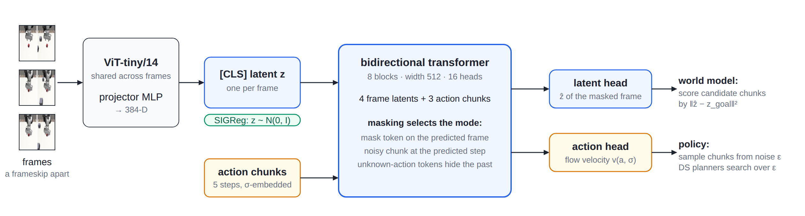
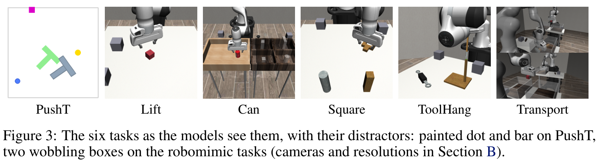

本轮于北京时间 2026-10-11 12:01 启动，检索截止 T 为 2026-10-11 12:01:27 +08:00；覆盖 2026-10-08 12:01:27 至 T，采用近 72 小时窗口，未回退七天。本轮启动已晚于当日 04:00 发布目标。

这篇论文由 **Shashank Hegde、Alexander Popov、Elie Aljalbout、Nikolai Smolyanskiy** 完成，署名机构为 **NVIDIA**。它把两个容易混在一起的问题拆开：模型应当保留哪些视觉信息，以及规划器可以在什么动作范围内相信模型。值得细读的是两者如何连接，而不是把“没有像素重建”直接等同于可靠控制。[论文 v1 全文](https://arxiv.org/html/2610.12407v1) · [PDF](https://arxiv.org/pdf/2610.12407v1)

## 今日精选

| 工作与来源 | 首次公开证据 | 方法 | 为什么值得读 |
|---|---|---|---|
| **首推** · [LeWAM](https://arxiv.org/abs/2610.12407) | 2026-10-09，arXiv 新发布列表；未核实精确公开时刻 | 联合嵌入预测、四模式训练、噪声空间规划 | 在同一模型里学习“会怎样”和“怎样做”，再用生成策略约束规划候选；证据限于仿真。 |

## 为什么预测得更像，不一定操作得更好

先看一个具体任务：机械臂需要夹起桌上的红色方块，但画面里还有两只不断晃动的灰盒。灰盒很显眼，却不接触机器人，也不改变方块动力学。若训练目标是重建下一帧，模型必须同时学习方块运动、夹爪运动和灰盒的无关变化。对于只有约两百条示教、容量有限的模型，这会让视觉表示承担与控制无关的负担。另一条路线是只预测潜在特征，但如果这套特征从未被要求解释动作，它也未必保留夹取所需的精细状态。[§1、§3、§5.1](https://arxiv.org/html/2610.12407v1#S1)

LeWAM 因而将联合嵌入预测架构（Joint-Embedding Predictive Architecture，JEPA）与世界—动作模型（World-Action Model，WAM）结合。它不要求把未来特征还原成像素，而是让同一表示同时支持前向预测、反向预测、逆动力学和策略生成。前两者约束状态之间的关系，后两者让表示接受动作监督；“什么值得编码”由这些任务共同决定。论文不是首次提出无解码器世界模型，也不是首次联合建模动作与视觉，其变化在于把这几类学习信号放进同一个端到端训练系统。[§2–3](https://arxiv.org/html/2610.12407v1#S3)

但更好的表示并不能消除模型误差。假设规划器在动作空间随意搜索，它可能找到一种示教从未覆盖的动作：模型预测方块会到达目标，真实仿真执行却失败。搜索越努力，越可能利用这种“预测便宜、实际不可行”的漏洞。作者的第二个设计因此不是继续增大搜索范围，而是让候选动作都经过已学策略生成，再在这些候选中优化。这里的模型预测控制（Model Predictive Control，MPC）既需要世界模型评价未来，也需要策略提供动作先验。[§4.1–4.3](https://arxiv.org/html/2610.12407v1#S4)

## 从图像到预测与动作：同一个网络怎样承担四种任务

*图 1｜原文 Figure 2。沿箭头从左向右读：图像经共享编码器与投影器成为每帧一个向量；动作块作为另一类输入进入双向 Transformer；上方输出头预测被遮蔽帧的特征，下方输出头预测动作生成所需的流速度。绿色正则项约束表示分布，遮蔽方式决定本次执行哪种任务。来源：[v1 Fig. 2](https://arxiv.org/html/2610.12407v1#S3.F2)、[官方 HTML 原图](https://arxiv.org/html/2610.12407v1/figures/method/arch.png)，Shashank Hegde 等，CC BY 4.0，未改绘。图中代价示意用了距离平方，正文式 (1) 使用欧氏距离，下面按正文说明。*

图 1 左侧的输入不是语言或机器人特权状态，而是相机图像。训练窗口包含四帧，帧间隔为五个环境步；前三帧构成历史，第四帧提供未来监督。相邻帧之间各有一个五步动作块，因此窗口共有三个动作块。单步动作维度依任务而变：PushT 的一个块为 10 维，普通 robomimic 操作为 35 维，双臂 Transport 为 70 维。下文的时间下标指这些采样帧，而非逐个原始控制步。[§3、附录 B](https://arxiv.org/html/2610.12407v1#S3)

每帧先缩放至 224 像素，经从零训练的视觉 Transformer（Vision Transformer，ViT）和多层感知机（Multilayer Perceptron，MLP）投影为一个 384 维向量 $z_t$。这些向量既给策略读，也给动力学预测和规划代价使用。没有另外一套像素重建表示，更没有调用预训练视频生成器。为了避免所有图像都被编码成同一个常数，作者沿用随机投影式各向同性高斯正则（Sketched Isotropic Gaussian Regularization，SIGReg），将批内潜变量约束到各向同性高斯分布；其随机投影与分布匹配机制来自 [LeJEPA §4](https://arxiv.org/html/2511.08544#S4)，并非本文新提出。预测目标来自正在更新的编码器，不使用指数移动平均目标网络，也不对目标端停止梯度。[§3、附录 B–C](https://arxiv.org/html/2610.12407v1#A2)

*图 2｜原文 Figure 1。灰色表示被遮蔽的图像特征，红色虚线表示带噪动作，紫色表示不透露过去动作的占位符。四列共享参数，但输入信息和监督对象不同；策略列也预测未来特征，并不是只训练一个独立动作头。来源：[v1 Fig. 1](https://arxiv.org/html/2610.12407v1#S3.F1)、[官方 HTML 原图](https://arxiv.org/html/2610.12407v1/figures/method/modes.png)，Shashank Hegde 等，CC BY 4.0，未改绘。*

图 2 的前向模式遮掉末帧特征，同时给出干净的三个动作块，要求网络回答“按这些动作走，会看到什么状态”；反向模式遮掉首帧，从后续帧和动作恢复过去状态。它们都用均方误差约束潜变量预测。逆动力学模式给出全部四帧，把最后一个动作块加噪，要求恢复连接前后状态的动作。它补上了纯预测训练没有直接强调的问题：画面中的变化究竟对应什么控制。[§3，Modes](https://arxiv.org/html/2610.12407v1#S3)

策略模式最接近部署：末帧不可见，最后动作带噪，网络只能根据历史生成动作，并同时预测未来特征。过去两个动作块也被替换成“未知动作”占位符，避免直接延续示教者的最近动作成为捷径。每批图像只编码一次，但共享主干分别执行四种模式；前向损失权重为 2，其余三种为 1，另加表示正则。这样，动作生成误差可以一路影响视觉编码器，而不是在已经冻结、可能不适合控制的表示上另接策略。[§3、Table 5](https://arxiv.org/html/2610.12407v1#A2.T5)

动作头使用整流流（Rectified Flow）。训练时把真实动作块 $a$ 与标准高斯噪声 $\epsilon$ 混合为 $a_\sigma=(1-\sigma)a+\sigma\epsilon$，其中 $\sigma$ 在 0 到 1 均匀采样；网络学习的速度目标为 $\epsilon-a$。推理时从噪声端出发，用八步欧拉积分得到动作块。固定历史与初始噪声后，这个采样过程是确定的，记为 $a=g(\epsilon;\mathbf z_t)$，其中 $\mathbf z_t=(z_{t-2},z_{t-1},z_t)$。这个确定映射正是后面能够“搜索噪声”的基础。[§3，Action Generation](https://arxiv.org/html/2610.12407v1#S3)

训练只用离线人类示教，不用强化学习奖励更新策略；每任务训练 300 个 epoch，保留 10% 数据作留出评估，使用五个训练种子。直接控制时，只需编码最近观测、调用策略模式生成动作块并执行，再接收新图像。增加规划以后才需要目标潜变量与多次模型展开，因此不能把八步动作采样的成本当成整套 MPC 的推理成本。[§5.1、附录 B–D](https://arxiv.org/html/2610.12407v1#A4)

## 为什么搜索噪声，以及一轮规划到底做什么

规划首先需要知道“想去哪”。论文从给定示教中找与当前潜变量最近的一帧，再取其后 25 个环境步的观测编码为目标 $z_g$。这相当于借示教提供局部前进方向，不是网络自行从语言理解任意新任务。前向模式 $\hat f$ 预测执行动作块后的潜变量，正文式 (1) 的代价为

$$
\hat c(a)=\left\|\hat f(\mathbf z_t,a)-z_g\right\|_2.
$$

其中 $a$ 是候选动作块，$z_g$ 是检索目标，距离越小表示模型预测的结果越接近目标。它没有显式奖励头或价值函数；距离是否反映任务进展，取决于表示与目标检索是否合适。多个动作块的计划只比较展开末端与目标的距离，所以错误预测仍可能影响排序。[§4.1 式 (1)、附录 D](https://arxiv.org/html/2610.12407v1#S4.SS1)

普通动作空间 MPC 直接修改未来动作序列；扩散引导（Diffusion Steering，DS）则修改生成每个动作块的初始噪声。要注意，噪声维度仍等于动作块维度，收益不是来自自动降维，而是来自 $g$ 把搜索变量映射到学过的动作结构。假如示教主要包含接近、夹取、抬升，策略会倾向于生成与这些行为一致的候选；搜索不会直接在原始动作坐标里任意跳动。论文继承已有噪声搜索思想，贡献在于每次决策都用世界模型在线评价，而非提出一种全新的采样优化器。[§2、§4.3](https://arxiv.org/html/2610.12407v1#S4.SS3)

一条计划包含 $H$ 个噪声向量。关键是后续动作要在**前面动作产生的想象状态**上解码，而不能全部使用最初的真实观测。正文式 (2) 给出的循环是

$$
\begin{aligned}
a_h &= g(\epsilon_h;\hat{\mathbf z}_{h-1}),\\
\hat z_h &= \hat f(\hat{\mathbf z}_{h-1},a_h),\\
\hat{\mathbf z}_h &= \operatorname{shift}(\hat{\mathbf z}_{h-1},\hat z_h).
\end{aligned}
$$

这里 $h$ 是计划中的块序号，$\epsilon_h$ 是该块的初始噪声，$\hat{\mathbf z}_0=\mathbf z_t$；$\operatorname{shift}$ 丢掉最旧历史向量并加入预测向量。于是，一条候选计划会交替调用策略模式和前向模式：先想象动作，再想象动作结果，再根据结果想象下一块。展开到末端后，用 $\|\hat z_H-z_g\|_2$ 打分。[§4.3 式 (2)、Algorithm 1](https://arxiv.org/html/2610.12407v1#alg1)

搜索从标准高斯先验开始，每轮提出 64 条候选，展开五个块，执行三轮分布更新；交叉熵方法（Cross-Entropy Method，CEM）用八条精英计划重新拟合分布。第一轮只是从策略先验中采样并筛选，后两轮才利用评分改变候选分布。最终只执行选中计划的第一块，之后重新观察并规划，避免把五个块一次性开环执行。其它采样更新器沿用相同预算，因此比较的核心是候选如何生成与更新。[§4.3、附录 D](https://arxiv.org/html/2610.12407v1#A4)

还有一个容易遗漏的步骤：不断把高分噪声平均起来，会使噪声范数变小，相当于改变生成策略的采样温度。训练时的 $A$ 维标准高斯噪声，范数主要集中在 $\sqrt A$ 附近；作者在解码每个候选前做投影：

$$
\epsilon\leftarrow\sqrt A\,\frac{\epsilon}{\|\epsilon\|_2}.
$$

$A$ 是一个五步动作块的维度，投影保持方向并恢复典型半径。搜索分布本身仍在欧氏空间更新，只有送给策略的候选被投影。其作用是减少靠缩小噪声获得的温度变化，让优化主要选择生成方向。这里应保留一个边界：半径与训练分布相符，不代表每个优化后的方向都对应可靠动作，更不能证明多步动力学没有误差；它是有效的经验约束，而非防止模型被利用的数学保证。[§4.4](https://arxiv.org/html/2610.12407v1#S4.SS4)

## 实验支持到哪一步

*图 3｜原文 Figure 3，完整六面板及原图注。PushT 中加入不受动作影响的点与横条，其余场景加入晃动灰盒；Transport 将双臂肩部相机画面拼接。这里展示的是仿真观测，不能当作真机实验照片。来源：[v1 PDF 第 6 页 Fig. 3](https://arxiv.org/pdf/2610.12407v1#page=6)，Shashank Hegde 等，CC BY 4.0；仅裁去图外页面内容，未修改面板。*

实验使用 PushT 的 206 条人类示教，以及五项 robomimic 任务各 200 条熟练人类示教，模型仅输入图像。主闭环评测每模型每任务为五个训练种子 × 50 个环境初始种子，即 250 次 rollout。对照是作者按共同协议、约 4100 万参数重新实现的模型；其中重建式 RecWAM 借用 Cosmos Policy 架构，不能把结果读成击败其原版大规模预训练系统。[§5.1–5.4、附录 C](https://arxiv.org/html/2610.12407v1#S5)

最直接的控制证据是：Square 的直接策略成功率为 80.4%±1.5%，加入 DS-CEM 后为 87.2%±4.7%；但 Can 从 82.8%±6.1%降至 78.8%±4.5%，规划并非逐任务必胜。投影消融中，Can 不投影仅为 23.0%±8.0%，说明“搜索噪声”还不足够，如何约束噪声同样关键。这些数值来自 Tables 3–4；表注明每格 50 个 episode，误差按训练种子统计，Table 4 明确为种子 0–4 的均值与标准差。[§5.5](https://arxiv.org/html/2610.12407v1#S5.SS5)

表示探针则给出机制旁证：六任务平均任务状态 $R^2$ 为 0.80，前向 JEPA 对照 LeWM 为 0.62；LeWAM 的干扰物线性可读性接近零。不过原表把负 $R^2$ 截为零，因此不能据此断言表示完全不含任何干扰信息，也不能把探针分数直接视为闭环可靠性。[Table 2](https://arxiv.org/html/2610.12407v1#S5.T2)

## 边界与复现状态

这项工作仍是小规模、按任务训练的仿真研究。动态干扰被设计成不影响物理状态，尚未验证真实遮挡、接触变化或跨任务泛化；目标也来自示教检索。作者明确把真机数据与更快的规划列为后续工作，不能从这里推出可实时部署的通用机器人模型。截至 T，未找到能与这四位作者及该 arXiv ID 对应的官方代码、权重或独立项目页；搜索中存在其它同名 LeWAM，不能混用其代码、真机结果或开放声明。

它最有价值的设计，是把动作监督用于塑造预测表示，再把学到的生成过程用于限制规划候选。实验说明这两种约束可以互补，但既没有消除模型误差，也没有证明更多推理计算必然带来更好的操作。

## 来源与首发核验

| 工作 | 最早可核验的公开证据 | 版本与交叉核验 |
|---|---|---|
| LeWAM，arXiv:2610.12407 | [2026-10-09 cs.RO 新发布批次](https://arxiv.org/list/cs.RO/new)中列为新稿；批次日期为来源标注，未确认精确公开时刻 | [v1 历史](https://arxiv.org/abs/2610.12407v1)记录提交于 2026-10-08 17:46:03 UTC，即北京时间 10-09 01:46:03；提交不等于公开。未找到更早的同一工作官方公开记录。 |

本轮读取了 arXiv cs.RO、cs.LG、cs.CV 新列表，并检索作者、机构项目、GitHub、OpenReview 与会议官网线索；按基础 arXiv ID、DOI、规范化标题、官方 URL 及工作身份比对仓库已有原稿与规范化文章，未发现本项重复。LAC-WM 已有 [ICML 2026 会议录](https://proceedings.mlr.press/v306/huang26bv.html)，不因新上传 arXiv 而重新计为新成果。OpenReview 搜索页本轮读取失败，跨站检索覆盖不完整；本文依据已完整读取的 LeWAM v1 HTML、14 页 PDF 与 arXiv 发布记录，不据此宣称其它来源没有新成果。

方法核验位置为 v1 §3、Figures 1–2；规划为 §4、正文式 (1)–(2)、Algorithm 1；训练预算与目标检索为附录 B–D；实验与消融为 §5、Tables 2–4。三张配图保留原图编号，前两张为官方 HTML 原图，第三张取自同版本 PDF；许可为 [CC BY 4.0](https://creativecommons.org/licenses/by/4.0/)。
