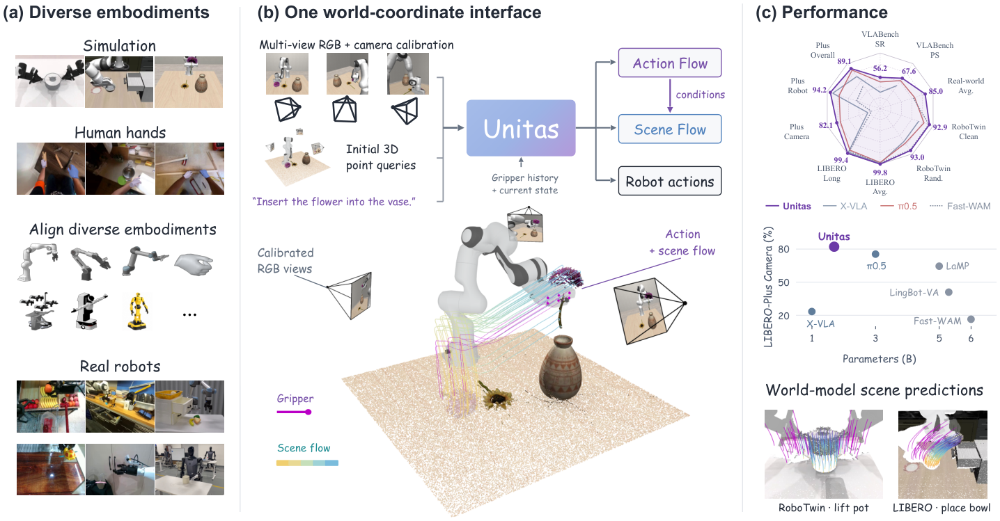
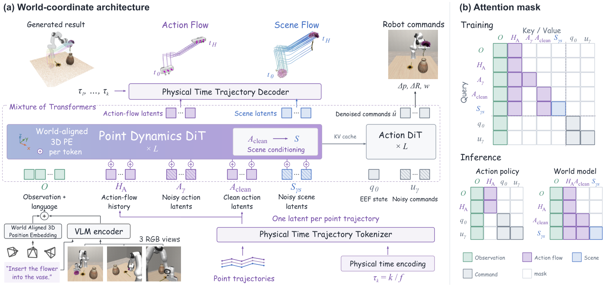
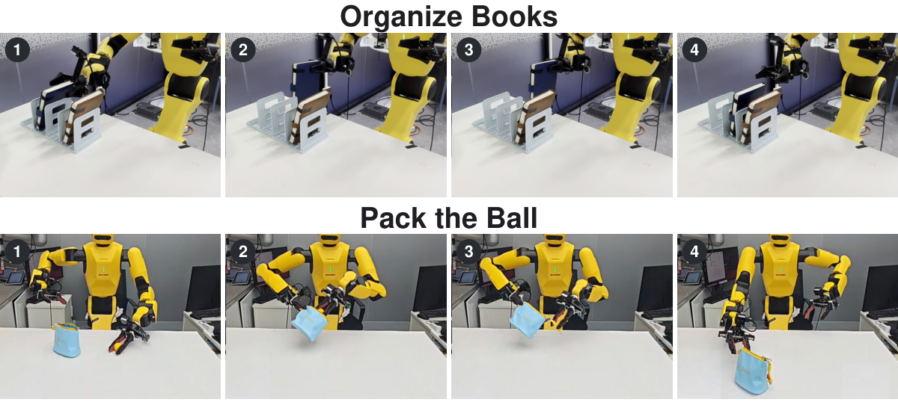

# UNITAS: A 3D-Native World Action Model for Embodied Manipulation

本轮实际启动及检索截止均为 2026-10-12 01:58:11（Asia/Shanghai）；覆盖 2026-10-09 01:58:11 至 2026-10-12 01:58:11，采用近 72 小时窗口，未回退到 7 天。今天只收入一项：UNITAS 把“机器人下一步怎么动”和“这次运动会把场景推向哪里”放进同一个三维语言中，却仍允许部署时只运行策略分支。它最值得读的不是又一个更大的视觉—语言—动作模型，而是把跨机器人形态、跨相机视角、跨采样率的数据接口具体化；相应代价是始终需要相机标定，且世界预测尚未成为在线规划闭环。

## 今日精选

| 工作与来源 | 首次公开 | 方法 | 为什么值得读 |
|---|---|---|---|
| **首推** · [UNITAS](https://arxiv.org/abs/2610.12099v1) | 2026-10-09 08:00（北京时间；按 arXiv 公告日程换算） | 三维原生 World Action Model（世界—动作模型）、轨迹词元、整流流 | 用统一世界坐标中的动作流连接人手、单臂和双臂数据，并把可执行动作与场景流联合学习；但真机证据仅覆盖两项任务，开放仓库目前还是发布预告。 |

## UNITAS 要解决什么问题

[论文](https://arxiv.org/abs/2610.12099v1) · [论文 HTML](https://arxiv.org/html/2610.12099v1) · [项目](https://unitas-wam.github.io/) · [官方仓库](https://github.com/DexForce/UNITAS)

这项工作由 Ruixiang Wang、Yongyi Su 等完成，论文署名机构包括香港中文大学（深圳）、DexForce、佛山大学、中山大学与华南理工大学。论文 v1 共 27 页；官方仓库可访问，但截至本次检索，模型权重、推理代码、训练代码和训练数据仍全部列为“coming soon”，因此目前可复核的是论文、HTML 原图与仓库说明，而不是端到端复现。

先看一个具体失效场景：双臂把一颗球装入袋中时，相机看到的是像素，控制器要输出两只末端执行器的相对位姿与夹爪状态，而世界模型还要判断袋口、球和机械臂随后怎样移动。如果动作只被编码为某台机器人专用的关节向量，它很难吸收人手视频或另一台机器人的经验；如果未来只在二维视频中生成，相机运动、遮挡和外观变化又会与真实几何运动纠缠。即使另行训练一个视频世界模型和一个策略，两者的“动作”接口也未必一致：前者读入抽象控制条件，后者输出可执行命令，模型预测得像并不等于机器人实际会那样动。

UNITAS 的选择是先规定一种共同的物理语言：所有观测、机器人或人手的运动以及场景点运动，都表达在以米为单位的局部世界坐标中。机器人动作不只是一串控制量，而是由正向运动学得到的夹爪几何点未来位移轨迹；人手则用 21 个 MANO 手部关键点的轨迹。这样，人手、单臂和双臂虽然自由度不同，却能以“哪些实体点在三维空间怎样移动”共享监督。模型仍单独生成可下发的动作块，所以这种统一表示不是用点轨迹替换控制接口，而是在策略与世界预测之间增加一个具身中介。

## 方法如何工作

*图 1｜左侧展示人手、单臂和双臂数据如何都变成统一世界坐标中的动作流；中部模型同时学习动作、动作流和场景流；右侧给出策略与预测示例。读图时应注意，彩色轨迹不是二维光流，而是带物理尺度的三维位移。来源：[论文 Fig. 1（v1）](https://arxiv.org/html/2610.12099v1#S1.F1)，原文按 [CC BY 4.0](https://creativecommons.org/licenses/by/4.0/) 发布。*

一次输入的上下文 $C$ 包含语言指令、当前多视角 RGB 观测、相机内外参以及历史动作流；当前末端执行器状态记为 $\mathbf q_0$。模型把输出分成动作流 $\mathcal A$、可执行动作块 $\mathbf u$ 和场景流 $\mathcal S$，其核心条件分解是论文式（3）：

$$
p_\theta(\mathcal A,\mathbf u,\mathcal S\mid C,\mathbf q_0)
=p_\theta(\mathcal A\mid C)\,p_\theta(\mathbf u\mid C,\mathbf q_0)\,p_\theta(\mathcal S\mid \mathcal A,C).
$$

这里 $p_\theta$ 是共享上下文下的生成模型。动作流与动作块并行生成，因而策略不必先等轨迹预测结束；场景流则显式以生成的动作流为条件，回答“若具身实体这样运动，环境点会怎样动”。部署为纯策略时，系统只计算第二项，不生成未来动作流和场景流。这个分解很重要：UNITAS 学到的是与动作一致的世界预测接口，但论文并没有让预测结果反过来搜索、筛选或修正动作，因此它不是模型预测控制器。

### 从像素到米制三维词元

RGB 图像先经 Florence-2 Large 编成视觉特征。若有深度 $D$，像素 $(u,v)$ 通过 $D K^{-1}[u,v,1]^\top$ 反投影，再由相机到世界的变换放进共同坐标系，所得三维位置经过傅里叶位置编码与视觉特征相加。若没有深度，模型沿每条相机射线在 0.1—2.0 米间采样 64 个候选深度，并学习注意力权重来汇聚它们；训练时还用可靠深度产生的三维位置编码作为停止梯度的教师信号。这里的“无深度”只表示不输入深度图，相机内外参仍是依赖项。

动作流查询点也来自明确的几何。每条机器人手臂从 URDF 模型选取 20 个夹爪几何点，经当前姿态与正向运动学定位；人手用 21 个 MANO 关键点。场景查询点从去除机器人区域后的点云采样。模型预测的不是绝对坐标，而是这些点相对当前时刻的未来位移；局部世界坐标在一个预测窗口内固定，下一窗口可以重新建立，不能把它理解成贯穿整段任务的持久三维地图。

不同数据源帧率与时长不一，直接按帧编号编码会让“第十帧”失去物理意义。UNITAS 先训练一个物理时间感知的轨迹自编码器，把最多 3 秒、任意采样率的一整条点轨迹压成单个 256 维词元。其编码聚合见论文式（8）：

$$
\mathbf z_n=\frac{1}{\sqrt H}\sum_{k=1}^{H}
\left[(1+\mathbf a^{\mathrm{enc}}_k)\odot\mathbf h_{n,k}+\mathbf b^{\mathrm{enc}}_k\right].
$$

$n$ 是查询点，$k$ 是该点轨迹中的时间采样，$H$ 为轨迹长度，$\mathbf h_{n,k}$ 为位移特征；$\mathbf a^{\mathrm{enc}}_k$、$\mathbf b^{\mathrm{enc}}_k$ 由以秒为单位的物理时间调制产生，$\odot$ 表示逐元素乘法。除以 $\sqrt H$ 限制不同采样长度带来的尺度漂移。解码器再以目标时间戳调制词元并还原各时刻位移。该自编码器先以重建目标训练，随后冻结并标准化其潜变量；主模型因此学习的是统一轨迹词元，而不是同时追着一个不断变化的编码器。

*图 2｜上半部把相机标定后的视觉词元、语言、历史动作流、未来动作流、场景流与可执行动作接入 Mixture-of-Transformers；下半部的掩码给出依赖关系。场景分支能看见干净动作流，动作控制分支只读观测上下文和当前机器人状态，因此可单独裁出运行。来源：[论文 Fig. 2（v1）](https://arxiv.org/html/2610.12099v1#S3.F2)，原文按 [CC BY 4.0](https://creativecommons.org/licenses/by/4.0/) 发布。*

图 2 中，视觉与语言上下文、历史动作流可以双向注意；未来动作流能读取上下文和自身词元；场景流读取上下文、场景自身以及作为条件的干净动作流，却看不到加噪动作流。可执行动作分支读取视觉上下文、$\mathbf q_0$ 与动作词元，不读取未来流。网络由两个专家组成：点动力学 DiT（Diffusion Transformer，扩散 Transformer）为 28 层、宽度 1280、20 个注意力头，动作 DiT 为 28 层、宽度 640、10 个头；再加 Florence-2 Large 视觉语言骨干，总参数约 16.945 亿。

### 训练与部署的信息差

轨迹词元和动作块都用 Rectified Flow（整流流）学习。对真实目标 $\mathbf y$、高斯噪声 $\boldsymbol\epsilon$ 与时间 $\gamma\in[0,1]$，训练点为 $\mathbf y_\gamma=(1-\gamma)\boldsymbol\epsilon+\gamma\mathbf y$，速度目标是 $\mathbf y-\boldsymbol\epsilon$。总损失把动作流、场景流和控制动作的整流流损失等权相加，并以 0.1 权重加入无深度射线位置编码的蒸馏损失；缺少某类标注的数据对相应项做掩码。尤其要注意，训练场景分支时输入的是真实示范动作流，而推理时它接收模型生成的动作流，这里存在尚未被单独量化的训练—推理差距。

预训练混合 RoboTwin、LIBERO、VLABench、DROID、AgiBot、RoboMIND、RH20T、VITRA 与自采 W1 共九类数据，既有人手也有机器人。主训练 20 万步、全局批量 1024，使用 AdamW；点与动作专家学习率为 $10^{-4}$，视觉语言骨干为 $10^{-5}$，预热 1000 步，在 64 张 64 GB BW1000_H DCU 上采用 FSDP。推理以 10 个 Euler 步并行生成动作流与动作块，需要世界预测时才继续生成场景流。在 RTX 5090D 上，论文报告只生成动作块为每块 55.77 毫秒，加入动作流为 122.51 毫秒；这些是模型前向延迟，不包含相机、通信与执行器闭环，不能直接换算成机器人控制频率。

## 实验说明了什么

作者先在 LIBERO、RoboTwin、VLABench 与扰动版 LIBERO-Plus 上检验策略，再在 RoboTwin 的保留片段和闭环滚动中评估三维场景预测。真机部分使用双臂平台完成“整理书籍”和“把球装袋”两项任务，每项每种方法 20 次独立试验；图 3 给出两项任务从接近、抓取到放置的连续关键帧。

*图 3｜上排是双臂整理书籍，下排是协同撑袋与装球；它说明成功必须保持双臂之间以及机器人与物体之间的几何关系，而不是只完成单次抓取。来源：[论文 Fig. 4（v1）](https://arxiv.org/html/2610.12099v1#S4.F4)，原文按 [CC BY 4.0](https://creativecommons.org/licenses/by/4.0/) 发布。*

| 真机成功率 | UNITAS | $\pi_{0.5}$ | Fast-WAM |
|---|---:|---:|---:|
| 整理书籍 | 18/20（90%） | 15/20（75%） | 13/20（65%） |
| 把球装袋 | 16/20（80%） | 11/20（55%） | 12/20（60%） |

两项合计 34/40，即论文摘要所称平均 85%；样本量仍小，论文未报告多随机种子均值或置信区间。世界模型方面，RoboTwin 保留集含 50 个任务、每任务一个干净轨迹和十个随机化轨迹，共 550 段 20 帧片段；UNITAS 的运动点平均位移误差为 0.427 厘米，PointWorld 为 0.656 厘米。闭环的自生成动作条件评测共 3 个任务 × 2 种场景设置 × 10 次，即 60 次，UNITAS 的运动点误差为 1.211 厘米，所列视频 WAM 为 2.579—3.554 厘米。不过视频基线需经跟踪器提升到三维，比较同时混入了重建误差。

最能解释机制的消融是在无大规模预训练的 LIBERO-Plus 上完成：完整三维位置编码、动作流和历史条件但不加场景流时，总成功率为 85.74%；去掉三维位置编码降到 81.35%，其中相机扰动子集从 79.11% 降到 66.73%；去掉动作流降到 78.89%，去掉历史降到 75.92%。这支持统一三维坐标、形态无关动作中介和历史都在起作用。再加入场景流只从 85.74% 增至 86.47%，约 0.73 个百分点，因此现有证据更强地支持“共享表示有益”，尚不足以说明显式世界预测已经显著改善控制。

## 结论的边界

UNITAS 把三维操作数据接口做得相当完整，但仍有三条边界。第一，无深度推理依然需要相机标定，标定漂移、遮挡与触觉缺失在两项真机任务中没有被系统覆盖。第二，世界分支依据生成的动作流预测未来，而执行器动作由并行的控制分支另行产生；较低场景误差间接说明二者相容，却不能证明两种输出在每个控制周期都严格一致。第三，策略模式会关闭未来流，模型没有用预测场景做候选动作搜索或在线重规划。

因此，这项工作的核心价值是一种可组合的三维表示：物理时间轨迹词元让异构采样率对齐，动作流让人手与不同机器人共享监督，因果注意力掩码又允许世界预测和快速策略从同一模型中按需取用。最有说服力的是跨扰动消融与明示分母的真机结果；最需要等待的是代码、权重和数据真正开放，以及更长任务、更强几何扰动和真实闭环规划中的验证。

## 来源与首发核验

| 工作 | 最早可核验的公开证据 | 版本与交叉核验 |
|---|---|---|
| UNITAS | [arXiv v1](https://arxiv.org/abs/2610.12099v1) 的提交记录为 2026-10-08 15:02:50 UTC；依 [arXiv 官方公告日程](https://info.arxiv.org/help/availability.html)，该时段稿件于美东时间周四 20:00 公告，即 2026-10-09 08:00 北京时间 | [arXiv v1 HTML](https://arxiv.org/html/2610.12099v1)；提交时刻与公开公告时刻已分开；[官方仓库](https://github.com/DexForce/UNITAS) 与论文标题、作者项目一致，未发现更早的同工作官方公开记录或匹配的 OpenReview 记录 |

方法与实验数字以 v1 的 Section 3、Equation (3)/(8)、Table 1–6、Figure 1/2/4 及 Appendix A–D 为准。检索覆盖 arXiv cs.RO/cs.LG/cs.CV 的最新公告，并交叉查看 OpenReview、论文 HTML、作者项目及官方仓库；基础 arXiv ID、规范化标题与官方 URL 均未在本站既有日报中出现。
