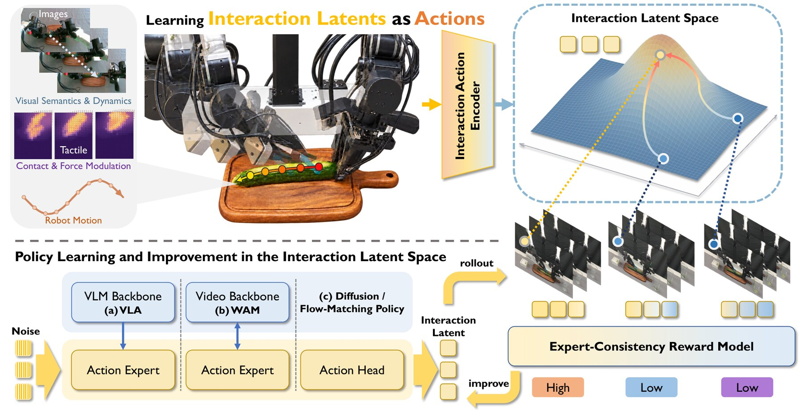
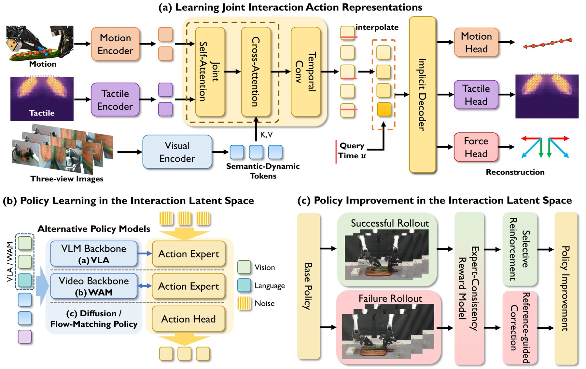
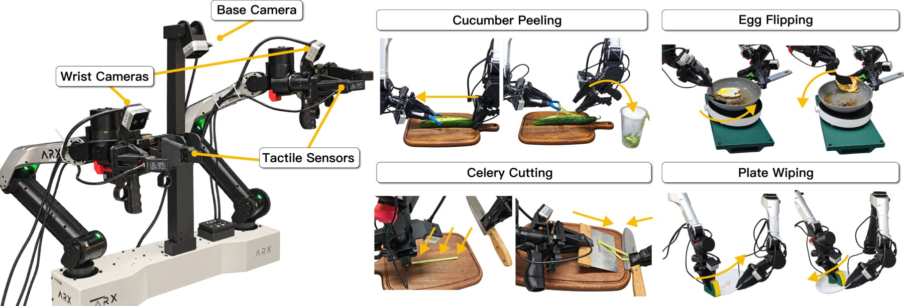

# Interaction Latents as Actions for Contact-Rich Manipulation

本轮实际启动与检索截止均为 **2026-10-15 12:02:41（北京时间，UTC+08:00）**，晚于同日 04:00 的发布目标；没有倒填 10 月 13、14 日。主检索窗口为 10 月 12 日 12:02:41 至截止时刻，已有合格且未报道成果，未启用七天回退。按仓库历史的基础 arXiv ID、规范化标题、官方 URL 与工作身份交叉比对，以下两项均未报道。

首推的 [arXiv 记录](https://arxiv.org/abs/2610.18855)把 v1 提交记为 10 月 13 日 17:59:16 UTC（北京时间 10 月 14 日 01:59:16），v2 修订记为 10 月 14 日 16:29:07 UTC（北京时间 10 月 15 日 00:29:07）。arXiv 明确说明提交要经过定时公告才公开，因此这些是**提交/修订时刻，不等同于精确公开时刻**；截至本轮截止，它已出现在 [cs.RO 最新列表](https://arxiv.org/list/cs.RO/recent)，这是能核实的公开证据，本次阅读全文、图和数值均以 v2 为准。

## 今日精选

| 工作 | 来源与定位 | 为什么值得读 |
|---|---|---|
| **首推** · [Interaction Latents as Actions for Contact-Rich Manipulation](https://arxiv.org/abs/2610.18855) | Yuhang Zheng、Yujie Zang、Yuchen Liu、Yupeng Zheng 等；新加坡国立大学（NUS）、Anyverse Robotics、Open-Phoenix Team、北京理工大学（BIT）、中国科学院大学（UCAS）与复旦大学（FDU） | 不再把触觉只当输入或旁路预测目标，而是让策略生成一个必须同时解释运动和接触演化的动作单位。 |
| [ForceWAM: Decoupling Future and Response Learning from Demo and Play Data for Contact-Rich Manipulation](https://arxiv.org/abs/2610.18852) | Zijun Xu、Wendi Chen、Xinkai Wang 等；复旦大学、上海交通大学、东南大学、上海创新研究院、南方科技大学与 Noematrix Ltd. | 用成功示教学“任务应怎样发展”，用无任务 play 数据学“动作怎样改变接触”，再以实时六轴力/力矩反馈执行。 |

第二项 [ForceWAM](https://force-wam.github.io/) 的 v1 提交时间为 10 月 13 日 17:58:44 UTC。它让力世界模型从成功示教联合预测未来视频与六轴力/力矩轨迹，再让逆动力学模型（Inverse Dynamics Model，IDM）从任务示教和 play 片段学习“当前观测 + 视觉—力未来 → 动作”。部署时，世界模型较慢地刷新参考未来，IDM 在一个动作块内复用参考并读入新测得的力/力矩。三类任务共四种条件每种评测 20 次，完整模型报告 85%–95% 成功率；在固定世界模型和更新预算时，加入每类 200 段 play 相比只用任务示教提高 15–45 个百分点。这个结果说明任务无关接触探索可以帮助执行，但比较仍局限于作者的平台、三类任务和同一批安全限制，不能直接推出 play 对任意端到端策略都有益。

## 动机：动作轨迹正确，为什么黄瓜仍可能削不下来？

想象机械臂让削皮刀沿黄瓜移动。两次关节轨迹可以非常接近，但一次刀刃持续贴住表面，另一次在中途失去接触；画面也可能都显示刀具沿着黄瓜运动，结果却完全不同。反过来，成功并不要求每次复现同一条力曲线：黄瓜粗细、摩擦和刀刃姿态变化时，合理的运动—接触组合也要随之变化。问题不只是“策略有没有看触觉”，而是**它输出的动作表示是否必须保留接触怎样建立、维持和释放**。

现有视觉—触觉策略通常把触觉当作当前条件，世界—动作模型（World-Action Model，WAM）还可以并行预测未来视觉、触觉和动作。但这两种做法都不强迫动作 token 自身包含接触信息：网络可以主要依赖运动监督完成动作分支，把触觉留在旁路特征或辅助头里。ILA（Interaction Latents as Actions，交互潜变量即动作）的改变发生在生成目标上：策略不直接生成 14 维双臂关节与夹爪目标序列，而是生成一组能被同一个解码器同时还原运动、局部触觉形变和整体形变的潜变量。接触信息因而不是可选提示，而是动作表示的组成部分。

*图 1｜原文 Figure 1，论文 v2。上半部把多视角图像、触觉形变与机器人运动编码到交互潜空间；下半部显示 VLA、WAM 或从头训练的流匹配策略都生成这种潜变量， rollout 再由专家一致性模型评价并改进。来源：[作者项目页原图](https://mrsecant.github.io/ILA/proj_page/assets/images/teaser.png)、[论文 v2 Figure 1](https://arxiv.org/html/2610.18855v2#S1.F1)。作者页面未声明开放许可；此处仅作研究评述所必需的低分辨率引用，权利归原作者，其他复用需另行获授权。*

## 沿完整信息流理解 ILA

图 2 把方法拆成三段：先学一个可解码的交互动作空间；再让不同策略在这个空间生成动作；最后在同一空间评价成功和失败 rollout，并做离线改进。三段共享潜变量的语义，却不是端到端同时训练。

*图 2｜原文 Figure 2，论文 v2。(a) 联合编码与隐式解码；(b) 三类策略以交互潜变量为生成目标；(c) 成功 rollout 做奖励加权，失败 rollout 用兼容专家参考修正。来源：[作者项目页原图](https://mrsecant.github.io/ILA/proj_page/assets/images/pipeline.png)、[论文 v2 Figure 2](https://arxiv.org/html/2610.18855v2#S3.F2)。作者页面未声明开放许可；此处按研究评述所必需的低分辨率引用，权利归原作者，其他复用需另行获授权。*

### 第一段：把运动、接触和视觉上下文压进同一个瓶颈

一段示教从时刻 $t$ 开始，输入是长度为 $H$ 的动作序列 $A_t$、同步的三维触觉形变场 $S_t$，以及片段开始时可见的多视角图像历史 $I_t^{\mathrm{hist}}$。论文把编码写成：

$$
z_t^{\mathrm{enc}}=E_\phi(A_t,S_t;V_t)\in\mathbb{R}^{K\times d_z},\qquad V_t=E_{\mathrm{vis}}(I_t^{\mathrm{hist}}),\quad K<H.
$$

$E_\phi$ 是交互编码器，$E_{\mathrm{vis}}$ 是视觉分支，$z_t^{\mathrm{enc}}$ 是时间压缩后的 $K$ 个潜 token，每个维度为 $d_z$。实现中 $H=128$、$K=32$、$d_z=128$，即把 30 Hz 下约 4.27 秒的运动—触觉片段按时间压缩四倍。每帧动作含双臂与夹爪共 14 个绝对目标；四个指尖传感器各输出 $35\times20\times3$ 的形变场。

图 2(a) 左侧的三条支路各有明确责任。Motion Encoder 与 Tactile Encoder 先分别把动作和触觉变成对齐 token，再以联合自注意力交换信息。Visual Encoder 使用冻结的 DINOv2 提取图像 patch：当前帧提供场景语义，局部时空注意力与相邻帧特征差提供隐式和显式运动线索，合成语义—动态（Semantics-and-Dynamics，S&D）token；这些 token 作为键和值，经交叉注意力注入运动—触觉表示。解码器不再直接读取图像，所以视觉若要帮助重构，只能把与交互有关的信息压进共享瓶颈。这种不对称设计避免模型把图像当作绕过潜变量的捷径。

右侧并非一次吐出固定网格的序列。隐式解码器接收查询时刻 $u$：先在相邻潜 token 间插值，再拼接时间编码，最后由 Motion、Tactile 和 Force 三个头分别重构动作、局部形变场与空间聚合形变。这里的 “Force” 是触觉切向形变的聚合代理，并未校准成牛顿。训练除原有 $H$ 个时刻外，还分层随机抽取 $2H$ 个帧间查询点，以线性插值构造监督，目标为：

$$
\mathcal L_{\mathrm{repr}}=\mathcal L_{\mathrm{rec}}(Q_{\mathrm{obs}})+\lambda_{\mathrm{int}}\mathcal L_{\mathrm{rec}}(Q_{\mathrm{int}}),
$$

$$
\mathcal L_{\mathrm{rec}}=\mathcal L_{\mathrm{act}}+\lambda_{\mathrm{tac}}\mathcal L_{\mathrm{tac}}+\lambda_{\mathrm{dir}}\mathcal L_{\mathrm{dir}}+\lambda_{\mathrm{map}}\mathcal L_{\mathrm{map}}.
$$

$Q_{\mathrm{obs}}$ 与 $Q_{\mathrm{int}}$ 分别是实测和插值查询集合，$\lambda_{\mathrm{int}}=0.5$；前两项是动作与形变场的逐元素 L1 重构，后两项约束直接预测的聚合形变及从重构形变场重新计算的聚合量。局部接触分布和整体施力趋势因此同时受到监督。表示模块约 10.03M 参数，不含冻结的 DINOv2 与后续策略；它训练 70 个 epoch、批量 256，学习率从 $2\times10^{-4}$ 余弦下降到 $5\times10^{-6}$。

### 第二段：策略生成“交互”，再解码成可执行关节目标

表示学好后，编码器、视觉分支与解码器全部冻结。作者离线把示教片段编码成标准化潜变量，作为块级流匹配（Flow Matching，流匹配）的生成目标。图 2(b) 的三条可替换路径分别是：在 $\pi_{0.5}$ 视觉—语言—动作模型（Vision-Language-Action Model，VLA）的视觉语言前缀后追加 S&D、触觉与本体历史 token；在 FastWAM 中保留视频生成目标，把这些 token 与语言合成视频和动作分支的交叉注意力条件；或从头训练一个 Diffusion Transformer（DiT）直接生成潜变量。三者最终都输出 $32\times128$ 的交互潜 token，经冻结解码器在固定 30 Hz 网格还原 128 个关节与夹爪目标。

这一步的因果边界很重要：策略只读取规划开始时已有的图像、触觉和本体历史，未来触觉只在离线表示学习中参与构造监督，部署时不需要预知真实接触。作者对 VLA、WAM 分别微调 50,000、40,000 步，从头训练的流匹配策略训练 100,000 步；三类均使用 AdamW、批量 128、学习率 $5\times10^{-5}$。实验设置一次执行完 128 个动作才同步重规划，因此 ILA 本身不是高频触觉反射控制器，约 4.27 秒动作块中途的意外接触主要依赖策略已经生成的轨迹和低层控制，而非重新调用生成模型。

### 第三段：同一潜空间既给成功片段加权，也修正失败片段

图 2(c) 解决的是部署后怎样利用 rollout，而不是在线强化学习。作者先把专家示教编码成参考潜变量集合，再训练一个以实测触觉描述为条件的流匹配参考模型。对于策略预测 $\hat z_t$，在流时间 $s$ 加入高斯噪声 $\epsilon$ 得到 $z_t^{\mathrm{noise}}=(1-s)\epsilon+s\hat z_t$，并以参考模型速度场的残差定义专家一致性能量：

$$
E_\omega(\hat z_t,c_t)=\mathbb E_{s,\epsilon}\left[\frac{1}{Kd_z}\left\|v_\omega(z_t^{\mathrm{noise}},s,c_t)-(\hat z_t-\epsilon)\right\|_F^2\right],\qquad r_t=-E_\omega.
$$

$c_t$ 是与潜 token 对齐的触觉描述，$v_\omega$ 是在专家参考上学到的条件速度场。残差小表示该片段更像同类接触条件下的专家交互，但它不是严格的负对数似然，也不保证任务成功。成功 rollout 中，奖励较高的片段在流匹配更新里权重更大，同时保留至少 0.3 的均匀权重，避免完全丢掉低分成功样本。

失败 rollout 则走另一条路：系统为低奖励片段检索观测相容的高奖励专家参考 $z_j^e$，把修正目标设为冻结旧策略估计 $\hat z_i^{\mathrm{ref}}$ 与专家潜变量的插值，$\alpha_{ij}=\exp(-d_{ij}/T_{\mathrm{comp}})$。观测差异 $d_{ij}$ 越小，目标越靠近专家；差异大时更保守地停留在旧策略附近，减少把不相容动作生搬过去。每项任务离线改进使用 50 条成功和 25 条失败 rollout，执行 2,000 次更新。这里的“奖励”和“修正”都针对完整动作块，且依赖人工收集并判定成功/失败的固定数据，不是无需标注的自主在线学习。

## 精简实验：提升来自表示，而不只是多看了触觉

*图 3｜原文 Figure 3，论文 v2。左侧为 ARX X5 双臂平台、基座/腕部相机和四个指尖 Xense 触觉传感器；右侧为削黄瓜、翻煎蛋、切芹菜和擦盘。来源：[论文 v2 Figure 3](https://arxiv.org/html/2610.18855v2#S4.F3)，由官方论文源码中的矢量原图清晰导出。论文采用 arXiv 非独占许可而非开放内容许可；此处仅作研究评述所必需的低分辨率引用，权利归原作者，其他复用需另行获授权。*

每项任务收集 150 条专家示教，共 600 条；每种方法每项任务评测 20 个 rollout。削皮、翻蛋和擦盘按完整 rollout 计成功，切芹菜按每一刀计分，每个 rollout 有 6 或 7 次切割，所以表中切割成功率的分母不是 20，原文也没有给出汇总刀数。相对各自“触觉作条件、直接生成动作”的基线，ILA 的四任务平均成功率在从头流匹配、VLA、WAM 三个家族分别提高 **26.0、36.5、21.0 个百分点**；这不是跨 seed 的置信区间，主表只给单一训练配置下的 20 次真机评测。

最能隔离核心主张的消融仍在 VLA 上保留策略的触觉输入，只移除潜表示学习中的触觉输入与监督：削皮从 50% 降到 20%，切芹菜从 37% 降到 10%。这支持“把接触写进动作目标”不同于“让策略看到触觉”。把连续时间隐式解码器换成参数量相当的离散解码器，流匹配策略在削皮/切芹菜从 75%/50% 降到 65%/44%，说明帧间监督与按时刻查询也有贡献。离线改进在削皮上把 FM-ILA 从 75% 提到 85%，执行形变代理误差从 $2.04\pm0.37$ 降到 $0.51\pm0.50$，即作者所称约 75% 降幅；但这个误差是传感器本地单位的切向形变代理，不能读成真实力误差降低 75%。

## 边界与复现状态

ILA 的价值是把“动作怎样运动”和“动作应伴随怎样的接触”绑定在一个可解码目标里，并让同一空间继续承担评价与修正；它尚未证明这种表示能跨机器人、跨触觉硬件或跨任务共享。四项任务均使用同一双臂平台和平行夹爪，触觉形变没有转换为牛顿；一次开环执行 128 步才重规划，也留下快速扰动下的反应速度问题。成功率来自 20 次真机 rollout，未报告多训练 seed 方差；线性 probe 与合成扰动只说明潜变量保留可读信息，不等于这些扰动在物理上可实现或闭环鲁棒。

截至截止时，[作者项目页](https://mrsecant.github.io/ILA/)提供论文、原图、视频与交互结果，但代码按钮仍标为 **Coming soon**，未发现公开训练代码、模型权重或数据许可，因而本轮只能核对论文内部的结构、预算和统计，不能复跑结果。图像仅用于逐图评述，保留原图号、版本和来源；未把作者未声明开放许可的材料描述成可自由再分发资源。
